# Arquitetura da Plataforma Fio

**Artefato 8 — Arquitetura da plataforma e requisitos**
**Responsável:** Kaio
**Prazo:** 29/10/2026
**Versão:** 2.0

---

## Índice

1. [Visão Geral](#1-visão-geral)
2. [Requisitos Funcionais e Regras de Negócio](#2-requisitos-funcionais-e-regras-de-negócio)
3. [C4 Model — Contexto, Contêineres e Componentes](#3-c4-model--contexto-contêineres-e-componentes)
4. [Diagrama de Casos de Uso (UML)](#4-diagrama-de-casos-de-uso-uml)
5. [Diagrama de Classes — Modelo de Domínio (UML)](#5-diagrama-de-classes--modelo-de-domínio-uml)
6. [Diagrama Entidade-Relacionamento — Banco de Dados](#6-diagrama-entidade-relacionamento--banco-de-dados)
7. [Diagrama de Sequência — Fluxos Principais (UML)](#7-diagrama-de-sequência--fluxos-principais-uml)
8. [Diagrama de Atividades — Regras de Negócio (UML)](#8-diagrama-de-atividades--regras-de-negócio-uml)
9. [Máquina de Estados — Ciclo de Vida do Dossiê (UML)](#9-máquina-de-estados--ciclo-de-vida-do-dossiê-uml)
10. [Diagrama de Fluxo de Dados — DFD Nível 0 e Nível 1](#10-diagrama-de-fluxo-de-dados--dfd-nível-0-e-nível-1)
11. [Diagrama de Implantação (UML)](#11-diagrama-de-implantação-uml)
12. [Descrição Detalhada dos Componentes](#12-descrição-detalhada-dos-componentes)
13. [Contratos de Integração](#13-contratos-de-integração)
14. [Regras de Negócio Consolidadas](#14-regras-de-negócio-consolidadas)
15. [Premissas, Limitações e Riscos](#15-premissas-limitações-e-riscos)
16. [Critérios de Aceite](#16-critérios-de-aceite)
17. [Histórico de Revisões](#17-histórico-de-revisões)

---

## 1. Visão Geral

O **Fio** é uma plataforma de apoio à investigação de fraudes para analistas do Sicredi. Ele recebe um alerta de transação suspeita e entrega um **dossiê investigativo** consolidado que combina:

- Score de risco gerado por um modelo de Redes Neurais treinado com os dados do case.
- Explicabilidade local por transação (top fatores via SHAP).
- Linha do tempo e contexto completo do associado.
- Desvios quantificados em relação ao padrão individual.
- Comparação com perfis similares: **não entregue neste ciclo** (C1 condicionado à viabilidade dos dados — declarado indisponível conforme decisão de 29/10/2026).
- Eventos e evidências relacionados ao caso.

**Princípio inviolável:** a decisão final é sempre do analista humano. O sistema não bloqueia cartões, não confirma fraudes automaticamente e não envia notificações ao associado.

**Arquétipo de IA:** sintetizador de conhecimento + gestor de fronteira humano-IA (conforme guia do case).

---

## 2. Requisitos Funcionais e Regras de Negócio

### 2.1 Tabela de Requisitos

| ID | Requisito | Prioridade | Regra de Negócio Associada |
|----|-----------|------------|----------------------------|
| RF-01 | O sistema recebe um evento/alerta e inicia a criação do dossiê. | Crítica | RN-01 |
| RF-02 | O sistema gera um score de risco de fraude (0–1) via modelo de IA. | Crítica | RN-02, RN-03 |
| RF-03 | O dossiê exibe identificação completa da transação. | Crítica | — |
| RF-04 | O dossiê exibe o score com nível de risco visual (baixo/médio/alto). | Crítica | RN-03 |
| RF-05 | O dossiê exibe os top-N fatores que influenciaram o score (SHAP). | Crítica | RN-04 |
| RF-06 | O dossiê exibe contexto do associado: cadastro, conta, cartão. | Alta | — |
| RF-07 | O dossiê destaca desvios quantificados em relação ao padrão individual. | Alta | RN-05, RN-06 |
| RF-08 | O dossiê lista eventos relacionados ao mesmo cartão/estabelecimento (últimos 30/90 dias). | Alta | RN-07 |
| RF-09 | O dossiê exibe disclaimer visível de que o resultado é apoio à investigação. | Crítica | RN-08 |
| RF-10 | O analista registra a decisão final (fraude / legítima / em análise). | Média | RN-09 |
| RF-11 | O analista consulta dossiês anteriores por customer_id, card_id ou acceptor_id. | Média | — |

### 2.2 Fora do Escopo do MVP

- Bloqueio automático de cartão ou conta.
- Integração em tempo real com sistemas transacionais do Sicredi.
- Autenticação e controle de acesso multiusuário.
- Pipeline de MLOps em produção (retreinamento automático).
- Notificações automáticas ao associado.
- Integração com bureaus externos (Serasa, SPC, etc.).

---

## 3. C4 Model — Contexto, Contêineres e Componentes

O **C4 Model** organiza a arquitetura em quatro níveis de zoom: Contexto (sistema no mundo), Contêineres (partes deployáveis), Componentes (módulos internos) e Código (classes). Para o MVP, detalhamos os três primeiros.

### 3.1 Nível 1 — Diagrama de Contexto

*Mostra quem usa o sistema, quais sistemas externos existem e como o Fio se posiciona.*

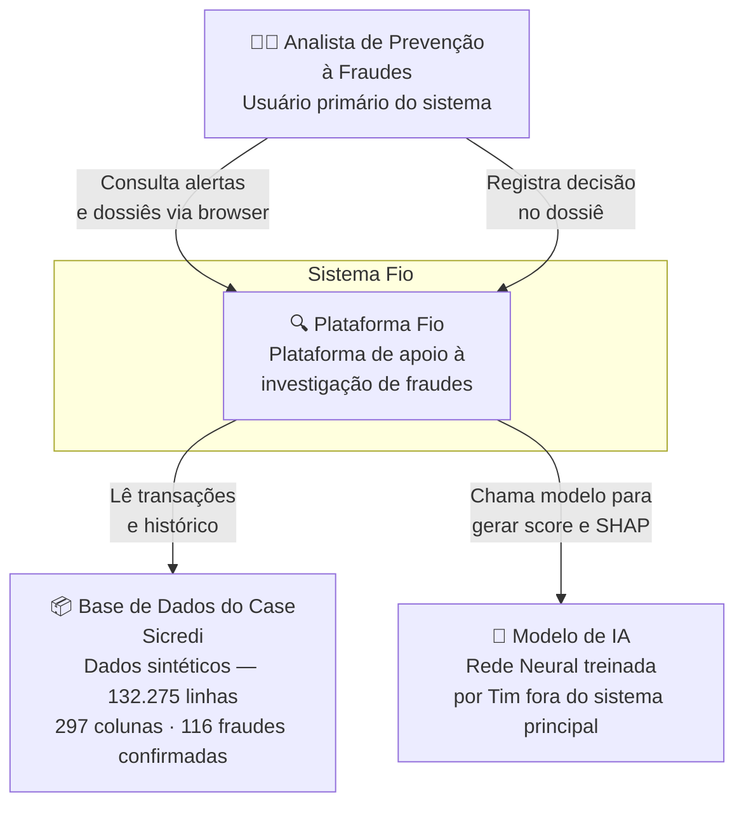

### 3.2 Nível 2 — Diagrama de Contêineres

*Mostra os processos/aplicações deployáveis e seus protocolos de comunicação.*

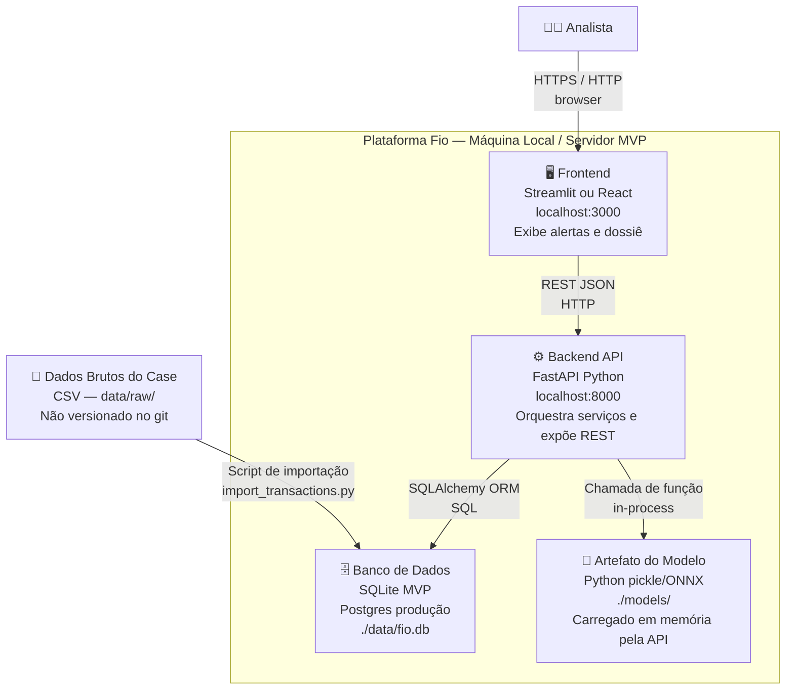

### 3.3 Nível 3 — Diagrama de Componentes (Backend API)

*Mostra os módulos internos do contêiner Backend API e suas dependências.*

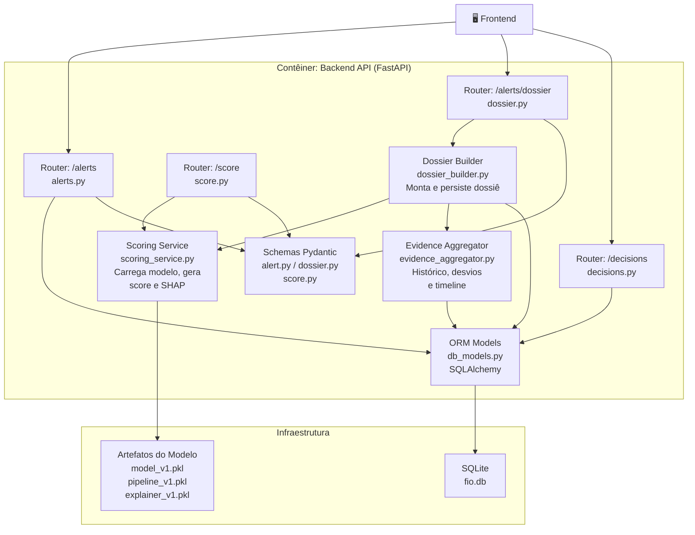

---

## 4. Diagrama de Casos de Uso (UML)

*Mostra os atores do sistema e as funcionalidades que eles podem acionar, refletindo os RFs priorizados.*

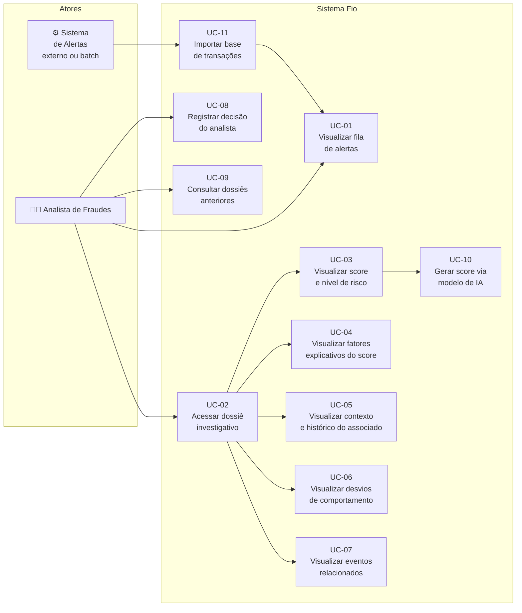

---

## 5. Diagrama de Classes — Modelo de Domínio (UML)

*Representa as entidades de negócio, seus atributos principais e as relações entre elas. Este é o vocabulário compartilhado de toda a equipe.*

```mermaid
classDiagram
    class Transaction {
        +String event_external_id PK
        +String customer_id FK
        +String card_id FK
        +String acceptor_id FK
        +String alert_id FK
        +Decimal amount
        +String tipo_transacao
        +String modalidade_transacao
        +DateTime event_occurred_at
        +String pos_environment
        +String mcc
        +String currency_code
        +String device_ip_country_code
        +String card_presence_flag
        +Decimal fraud_score
        +Boolean feedback_label
        +String transaction_status
    }

    class Customer {
        +String customer_id PK
        +String customer_name
        +String customer_segment
        +String customer_risk_rating
        +Decimal customer_total_balance
        +Decimal customer_total_credit_limit
        +String customer_region
        +DateTime customer_registration_date
        +String customer_kyc_lvl
    }

    class Card {
        +String card_id PK
        +String customer_id FK
        +String card_type
        +String card_brand
        +String card_status
        +Decimal card_credit_limit
        +Decimal card_available_balance
        +DateTime card_expiration_date
        +Boolean card_presence_flag
    }

    class Acceptor {
        +String acceptor_id PK
        +String acceptor_name
        +String acceptor_city
        +String acceptor_region
        +String acceptor_country_code
        +Decimal acceptor_risk
        +Boolean acceptor_risky_flag
        +Decimal acceptor_mastercard_risk
        +Decimal acceptor_visa_risk
    }

    class Alert {
        +String alert_id PK
        +String event_external_id FK
        +DateTime generated_at
        +String status
        +String source
    }

    class Dossier {
        +String dossier_id PK
        +String alert_id FK
        +DateTime generated_at
        +JSON transaction_section
        +JSON customer_section
        +JSON scoring_section
        +JSON deviations_section
        +JSON timeline_section
        +String disclaimer
        +String analyst_decision
        +DateTime decision_at
        +String model_version
    }

    class ScoreResult {
        +String event_external_id FK
        +Decimal fraud_score
        +String risk_level
        +List~TopFactor~ top_factors
        +String model_version
    }

    class TopFactor {
        +String feature_name
        +Decimal shap_value
        +String direction
        +String current_value
    }

    class AnalystDecision {
        +String decision_id PK
        +String alert_id FK
        +String decision
        +String notes
        +DateTime decided_at
    }

    class DeviationReport {
        +String customer_id FK
        +Decimal avg_amount_30d
        +Decimal amount_deviation_pct
        +String usual_mcc
        +Boolean mcc_unusual
        +String usual_hour_range
        +Boolean hour_unusual
        +Integer related_alerts_same_card_30d
        +Integer related_alerts_same_acceptor_30d
        +List~TimelineEvent~ timeline
    }

    class TimelineEvent {
        +DateTime event_occurred_at
        +Decimal amount
        +String acceptor_name
        +String mcc
        +Decimal fraud_score
    }

    Customer "1" --> "0..*" Card : possui
    Customer "1" --> "0..*" Transaction : realiza
    Card "1" --> "0..*" Transaction : utilizado em
    Acceptor "1" --> "0..*" Transaction : recebe
    Transaction "1" --> "0..1" Alert : gera
    Alert "1" --> "0..1" Dossier : possui
    Alert "1" --> "0..1" AnalystDecision : recebe
    Dossier "1" --> "1" ScoreResult : contém
    Dossier "1" --> "1" DeviationReport : contém
    ScoreResult "1" --> "1..*" TopFactor : detalha
    DeviationReport "1" --> "0..*" TimelineEvent : lista
```

---

## 6. Diagrama Entidade-Relacionamento — Banco de Dados

*Detalha o esquema físico das tabelas SQLite/PostgreSQL, com chaves e tipos de dados.*

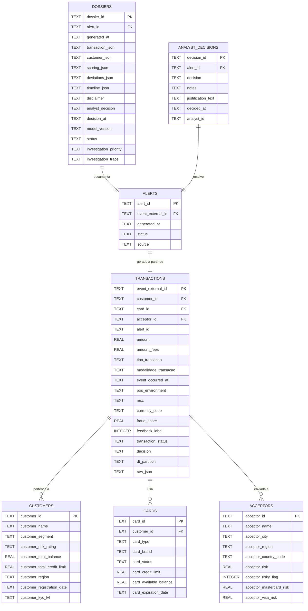

---

## 7. Diagrama de Sequência — Fluxos Principais (UML)

Os diagramas de sequência mostram a ordem temporal das mensagens entre participantes, incluindo condicionais (alt/opt) e loops.

### 7.1 Fluxo Principal — Geração e Exibição do Dossiê

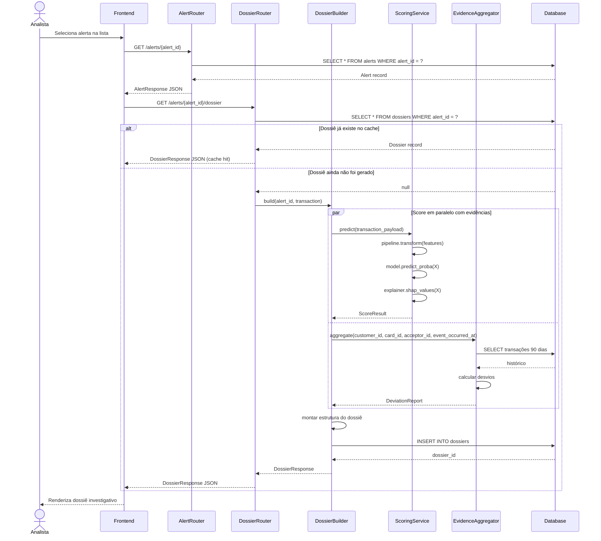

### 7.2 Fluxo de Registro de Decisão do Analista

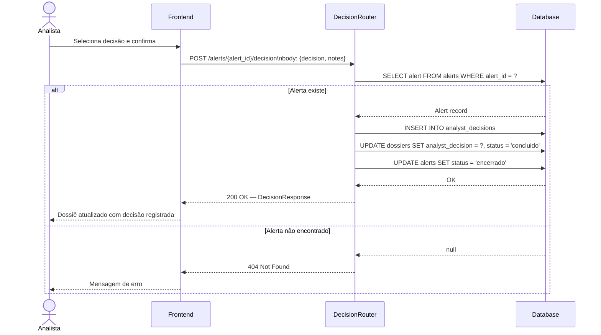

### 7.3 Fluxo de Consulta de Histórico do Associado

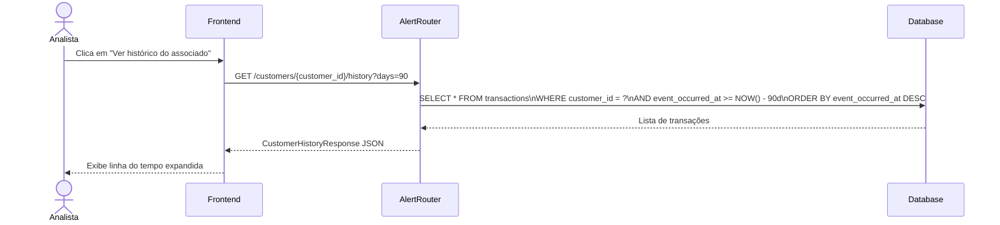

---

## 8. Diagrama de Atividades — Regras de Negócio (UML)

Os diagramas de atividade detalham o fluxo de decisão e os ramos condicionais das regras de negócio.

### 8.1 Atividade — Processamento do Score e Classificação de Risco

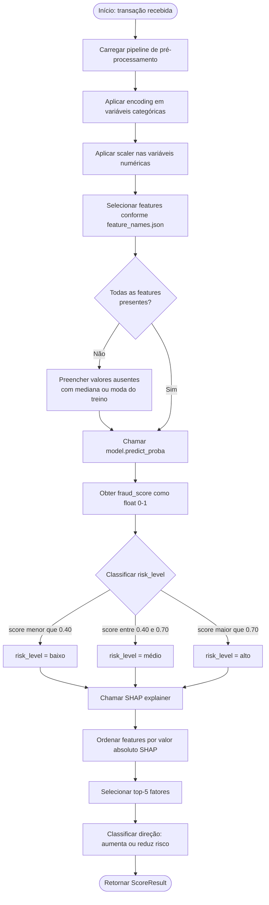

### 8.2 Atividade — Cálculo de Desvios Comportamentais

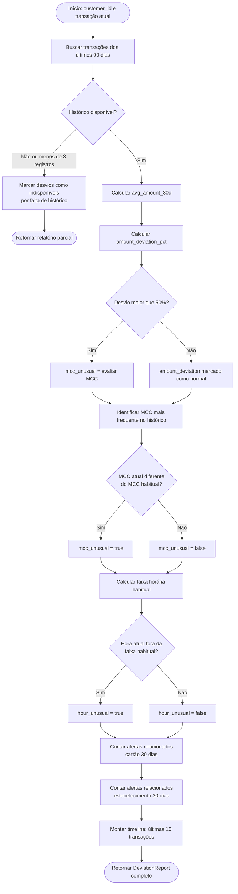

### 8.3 Atividade — Ciclo de Vida do Alerta (Visão do Analista)

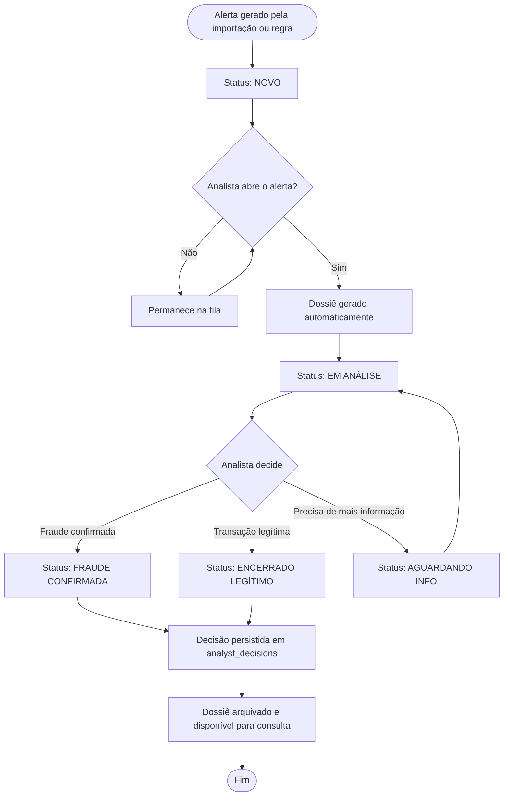

---

## 9. Máquina de Estados — Ciclo de Vida do Dossiê (UML)

*O diagrama de estados define os estados válidos de um dossiê e as transições permitidas entre eles.*

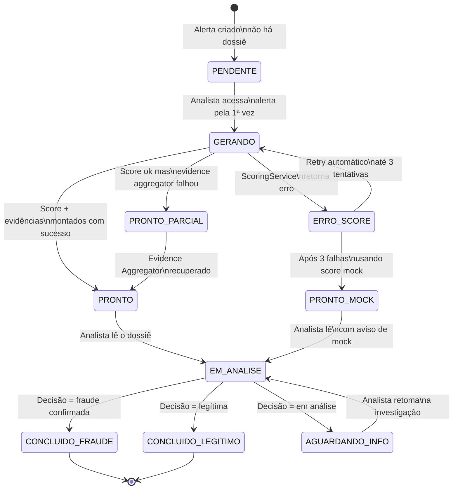

---

## 10. Diagrama de Fluxo de Dados — DFD Nível 0 e Nível 1

### 10.1 DFD Nível 0 — Visão do Sistema como Caixa Preta

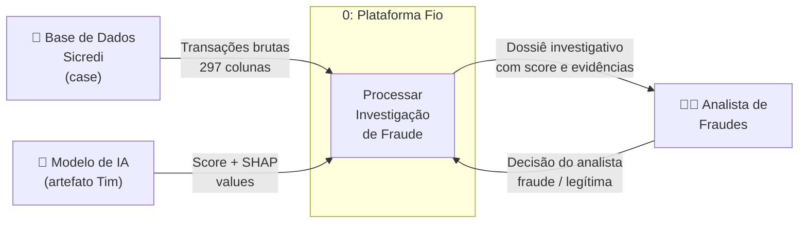

### 10.2 DFD Nível 1 — Processos Internos

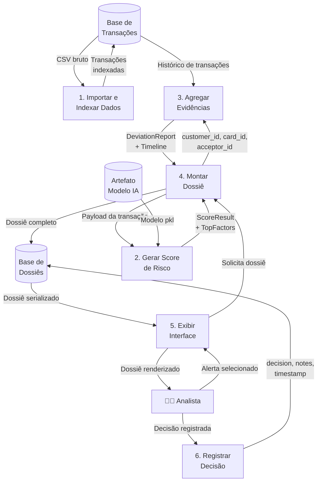

---

## 11. Diagrama de Implantação (UML)

*Mostra os nós de hardware/software, os artefatos deployados em cada nó e os protocolos de comunicação.*

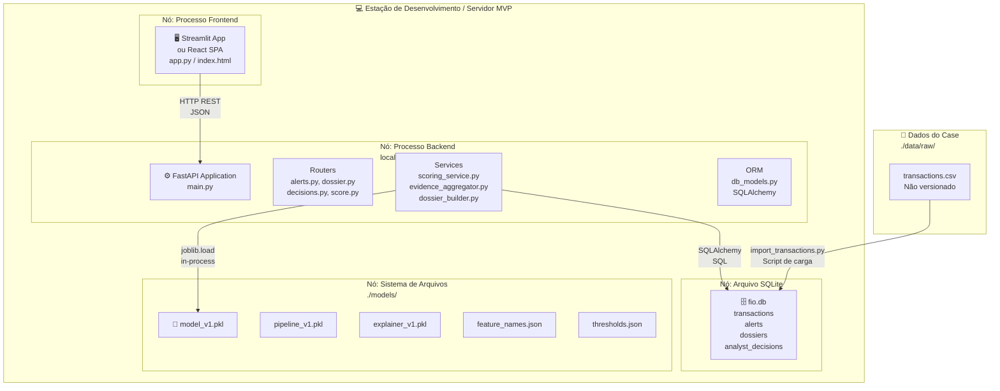

---

## 12. Descrição Detalhada dos Componentes

### 12.1 Interface do Analista (Frontend)

**Responsável:** Thi
**Tecnologia sugerida:** Streamlit (protótipo rápido) ou React + Vite (MVP com mais controle de UX)

**Responsabilidades:**
- Exibir a fila de alertas pendentes ordenada por `fraud_score` descendente.
- Abrir o dossiê investigativo ao selecionar um alerta.
- Apresentar o score com gauge visual de nível de risco (cores: verde/amarelo/vermelho).
- Exibir os top-N fatores como barras SHAP waterfall ou lista direcional.
- Exibir linha do tempo cronológica das transações do associado.
- Destacar visualmente os desvios (negrito, ícones, cor de alerta).
- Permitir que o analista registre a decisão final via formulário.
- Exibir **sempre** o disclaimer de apoio à investigação.
- Sinalizar claramente quando dados são simulados/mock.

**Telas mínimas do MVP:**
1. **Lista de Alertas** — tabela com `alert_id`, `customer_name`, `amount`, `event_occurred_at`, badge de `risk_level`, status do dossiê.
2. **Dossiê Investigativo** — painel único com seções: Transação, Score, Fatores, Contexto do Associado, Desvios, Linha do Tempo, Disclaimer, Decisão.

**Regras de interface (não funcionais):**
- O badge de nível de risco deve usar a paleta: verde (baixo), amarelo (médio), vermelho (alto).
- O disclaimer deve estar visível sem necessidade de scroll, preferencialmente no topo do painel de dossiê.
- Campos derivados de mock devem ter label `[SIMULADO]` visível.

---

### 12.2 Backend da Aplicação (API Layer)

**Responsável:** Thi
**Tecnologia:** Python com FastAPI + Uvicorn

**Endpoints:**

| Método | Rota | Body / Params | Response | HTTP Codes |
|--------|------|---------------|----------|------------|
| `GET` | `/health` | — | `{status: ok}` | 200 |
| `GET` | `/alerts` | `?status=&page=&size=` | `AlertListResponse` | 200 |
| `GET` | `/alerts/{alert_id}` | — | `AlertResponse` | 200, 404 |
| `GET` | `/alerts/{alert_id}/dossier` | — | `DossierResponse` | 200, 404, 202 |
| `POST` | `/alerts/{alert_id}/decision` | `DecisionRequest` | `DecisionResponse` | 201, 404, 422 |
| `GET` | `/customers/{customer_id}/history` | `?days=90` | `CustomerHistoryResponse` | 200, 404 |
| `POST` | `/score` | `ScoreInput` | `ScoreResult` | 200, 422 |

**Regras da camada de API:**
- `GET /alerts/{alert_id}/dossier` retorna `HTTP 202 Accepted` se o dossiê ainda está sendo gerado (estado `GERANDO`).
- Todos os erros de validação de schema retornam `HTTP 422` com detalhe do campo inválido.
- Todas as respostas de dossiê incluem obrigatoriamente o campo `disclaimer`.

---

### 12.3 Scoring Service

**Responsável:** Tim (modelo) + Thi (integração)
**Tecnologia:** Python — joblib/pickle para serialização

**Regras de negócio do Scoring Service:**

| ID | Regra |
|----|-------|
| RN-02 | O score é sempre um float no intervalo [0, 1] representando probabilidade de fraude. |
| RN-03 | A classificação de nível de risco segue os limiares: baixo [0–0.40), médio [0.40–0.70), alto [0.70–1.0]. Limiares calibráveis via `thresholds.json`. |
| RN-04 | Os top fatores SHAP são os 5 com maior valor absoluto de SHAP value. A direção é: `aumenta_risco` se SHAP > 0, `reduz_risco` se SHAP < 0, `neutro` se abs(SHAP) < 0.01. |
| RN-10 | Features ausentes na entrada são preenchidas com a mediana (numéricas) ou moda (categóricas) calculada no treino e armazenada no pipeline. |
| RN-11 | Se o arquivo do modelo não existir no path esperado, o serviço retorna score mock `0.5` com flag `mock_mode: true` e log de aviso. |

**Contrato de entrada:**

```json
{
  "event_external_id": "EVT_SYN_000000000",
  "amount": 667.0,
  "tipo_transacao": "credito",
  "modalidade_transacao": "cartao_nao_presente",
  "customer_id": "CUST_SYN_0002645",
  "card_id": "CARD_SYN_0018516",
  "acceptor_id": "MERCH_SYN_01104",
  "pos_environment": "ECOMMERCE",
  "mcc": "5411",
  "event_occurred_at": "2025-03-29T22:48:50",
  "device_ip_country_code": "BR",
  "card_presence_flag": "N",
  "cvv2_presence_indicator": "SYN_cvv2_presence_in_00"
}
```

> Conjunto mínimo indicativo. O contrato final é definido por Tim via `feature_names.json` após a EDA.

**Contrato de saída:**

```json
{
  "event_external_id": "EVT_SYN_000000000",
  "fraud_score": 0.87,
  "risk_level": "alto",
  "top_factors": [
    { "feature": "modalidade_transacao", "direction": "aumenta_risco", "shap_value": 0.32, "value": "cartao_nao_presente" },
    { "feature": "pos_environment",      "direction": "aumenta_risco", "shap_value": 0.28, "value": "ECOMMERCE" },
    { "feature": "amount",               "direction": "aumenta_risco", "shap_value": 0.19, "value": 667.0 },
    { "feature": "mcc",                  "direction": "neutro",        "shap_value": 0.009, "value": "5411" },
    { "feature": "card_presence_flag",   "direction": "aumenta_risco", "shap_value": 0.14, "value": "N" }
  ],
  "model_version": "v1.0.0",
  "mock_mode": false
}
```

---

### 12.4 Evidence Aggregator

**Responsável:** Thi (com apoio de Isa para lógica de desvio)
**Tecnologia:** Python + Pandas (ou SQL sobre a base local)

**Regras de negócio:**

| ID | Regra |
|----|-------|
| RN-05 | O desvio de valor é calculado como `(amount_atual - avg_amount_30d) / avg_amount_30d * 100`. Considerado desvio relevante se `> 50%`. |
| RN-06 | O MCC é considerado incomum se o MCC atual não está entre os 3 MCCs mais frequentes do histórico de 90 dias do associado. |
| RN-07 | A contagem de alertas relacionados considera os últimos 30 dias para o mesmo `card_id` e os últimos 30 dias para o mesmo `acceptor_id`. |
| RN-12 | A linha do tempo exibe no máximo as últimas 10 transações do associado, ordenadas da mais recente para a mais antiga. |
| RN-13 | Se o associado tiver menos de 3 transações no histórico, os campos de desvio são retornados como `null` com flag `insufficient_history: true`. |

**Contrato de saída:**

```json
{
  "customer_id": "CUST_SYN_0002645",
  "insufficient_history": false,
  "avg_amount_30d": 312.5,
  "amount_deviation_pct": 113.3,
  "amount_deviation_relevant": true,
  "usual_mcc": "5411",
  "current_mcc": "6411",
  "mcc_unusual": true,
  "usual_hour_range": "08:00-20:00",
  "current_hour": "22:48",
  "hour_unusual": true,
  "related_alerts_same_card_30d": 2,
  "related_alerts_same_acceptor_30d": 0,
  "timeline": [
    {
      "event_occurred_at": "2025-03-20T10:12:00",
      "amount": 200.0,
      "acceptor_name": "ESTABELECIMENTO_A",
      "mcc": "5411",
      "fraud_score": 0.12
    }
  ]
}
```

---

### 12.5 Dossier Builder Service

**Responsável:** Thi (com Igor para validação do conteúdo)

**Regras de negócio:**

| ID | Regra |
|----|-------|
| RN-08 | O campo `disclaimer` é obrigatório e imutável: `"Este dossiê é um apoio à investigação. A decisão de fraude ou legitimidade é de responsabilidade exclusiva do analista."` |
| RN-09 | O campo `analyst_decision` aceita somente os valores: `"fraude_confirmada"`, `"legitima"`, `"em_analise"` ou `null`. |
| RN-14 | O dossiê é persistido após a primeira geração bem-sucedida. Requisições subsequentes ao mesmo `alert_id` retornam o dossiê persistido sem regenerar (cache por persistência). |
| RN-15 | O dossiê inclui o campo `model_version` para rastreabilidade. Ao trocar de versão de modelo, dossiês anteriores não são regerados — permanecem com a versão original. |
| RN-01 | Um alerta só pode ter um dossiê ativo. Se o analista solicitar regeneração explícita (endpoint futuro), o dossiê anterior é arquivado. |

**Estrutura do dossiê completo:**

```json
{
  "alert_id": "ALERT_ID_SYN_000000010",
  "dossier_id": "DOSS_000000001",
  "generated_at": "2025-03-29T22:50:00",
  "status": "pronto",
  "transaction": {
    "event_external_id": "EVT_SYN_000000000",
    "amount": 667.0,
    "amount_fees": 4.0,
    "tipo_transacao": "credito",
    "modalidade_transacao": "cartao_nao_presente",
    "event_occurred_at": "2025-03-29T22:48:50",
    "acceptor_name": "ESTABELECIMENTO_SINTETICO_01104",
    "acceptor_city": "CIDADE_COMERCIO_SYN_058",
    "acceptor_region": "PA",
    "acceptor_country_code": "BR",
    "pos_environment": "ECOMMERCE",
    "mcc": "5411",
    "currency_code": "BRL"
  },
  "customer": {
    "customer_id": "CUST_SYN_0002645",
    "customer_name": "CLIENTE_SINTETICO_0002645",
    "customer_segment": "SYN_customer_segment_06",
    "customer_risk_rating": "baixo",
    "customer_region": "MT",
    "account_id": "ACC_SYN_0002645",
    "account_balance": 264989.0,
    "card_id": "CARD_SYN_0018516",
    "card_type": "credito",
    "card_brand": "BANDEIRA_A",
    "card_status": "SYN_card_status_01",
    "card_credit_limit": 136606.0
  },
  "scoring": {
    "fraud_score": 0.87,
    "risk_level": "alto",
    "top_factors": [],
    "model_version": "v1.0.0",
    "mock_mode": false
  },
  "deviations": {
    "insufficient_history": false,
    "amount_deviation_pct": 113.3,
    "amount_deviation_relevant": true,
    "mcc_unusual": true,
    "hour_unusual": true,
    "related_alerts_same_card_30d": 2,
    "related_alerts_same_acceptor_30d": 0
  },
  "timeline": [],
  "investigation_priority": "valor_atipico",
  "investigation_trace": [
    { "step": 1, "source": "scoring_service",     "reason": "transacao recebida — score calculado",          "result": "fraud_score=0.87 risk_level=alto", "gaps": [] },
    { "step": 2, "source": "evidence_aggregator", "reason": "indicio dominante: amount_deviation_relevant",   "result": "desvio 113% acima da media 30d",   "gaps": [] },
    { "step": 3, "source": "evidence_aggregator", "reason": "mcc_unusual identificado",                       "result": "MCC atual difere do habitual",      "gaps": [] },
    { "step": 4, "source": "evidence_aggregator", "reason": "verificacao de alertas relacionados",            "result": "2 alertas no mesmo cartao 30d",    "gaps": [] }
  ],
  "cluster_comparison": null,
  "cluster_comparison_status": "nao_entregue_neste_ciclo",
  "disclaimer": "Este dossiê é um apoio à investigação. A decisão de fraude ou legitimidade é de responsabilidade exclusiva do analista.",
  "analyst_decision": null,
  "justification_text": null,
  "decision_at": null
}
```

---

### 12.6 Modelo de IA (Neural Network + Explicabilidade)

**Responsável:** Tim
**Tecnologia:** Python — TensorFlow / PyTorch / scikit-learn

**Artefatos entregues por Tim:**

| Artefato | Path | Conteúdo |
|----------|------|----------|
| Modelo serializado | `models/model_v1.pkl` | Rede Neural treinada |
| Pipeline de pré-processamento | `models/pipeline_v1.pkl` | Scaler + Encoder + Feature Selector |
| Explicador SHAP | `models/explainer_v1.pkl` | SHAP KernelExplainer ou DeepExplainer |
| Lista de features | `models/feature_names.json` | Nomes exatos das colunas esperadas na entrada |
| Limiares de risco | `models/thresholds.json` | `{"baixo": 0.40, "alto": 0.70}` |
| Model card | `models/model_card.md` | Métricas, limitações, dataset, versão |

**Campos que nunca entram como feature no modelo em predição** (confirmado na EDA, Etapas 3–4):
- `feedback_label` (target — alvo supervisionado)
- `dispute_*` (resultado posterior à decisão)
- `fraud` (campo pós-evento: 5.763 positivos vs. 116 no alvo; não é recodificação do alvo, mas representa indicação operacional gerada após a transação — excluído)
- `decision` — especificamente `decision=deny` (leakage pós-evento confirmado na EDA)
- `transaction_status` — especificamente `transaction_status=declined` (leakage pós-evento confirmado na EDA)
- Identificadores puros: `customer_name`, `acceptor_name`, `card_pan`, `customer_citizen_id_number`, `customer_tax_number`

**Campos incluídos como features** (decisão D1, 29/10/2026):
- `fraud_score`, `visa_fraud_score`, `mc_fraud_score` externos: **incluídos como features** — forte discriminação (~4,4× razão de separação na EDA). Assumido que estão disponíveis no momento da autorização (scores de bandeira). **Esta premissa deve constar no model card de Tim** e ser explicitada na apresentação como limitação de validação com dados sintéticos.

---

### 12.7 Base de Dados

**Tecnologia sugerida:** SQLite (MVP) → PostgreSQL (produção)

**Schema detalhado das tabelas principais:**

#### Tabela `transactions`

| Coluna | Tipo | Constraint | Descrição |
|--------|------|------------|-----------|
| `event_external_id` | TEXT | PK | Identificador único da transação |
| `customer_id` | TEXT | FK → customers | Associado |
| `card_id` | TEXT | FK → cards | Cartão utilizado |
| `acceptor_id` | TEXT | FK → acceptors | Estabelecimento |
| `alert_id` | TEXT | NULL | Alerta associado se existir |
| `amount` | REAL | NOT NULL | Valor da transação |
| `tipo_transacao` | TEXT | | debito / credito |
| `modalidade_transacao` | TEXT | | cartao_presente / cartao_nao_presente |
| `event_occurred_at` | TEXT | NOT NULL | Timestamp ISO 8601 |
| `pos_environment` | TEXT | | ECOMMERCE / POS / ATM |
| `mcc` | TEXT | | Merchant Category Code |
| `fraud_score` | REAL | | Score externo do case |
| `feedback_label` | INTEGER | | 1=fraude, 0=legítima |
| `transaction_status` | TEXT | | approved / declined |
| `raw_json` | TEXT | | JSON completo da linha original |

#### Tabela `dossiers`

| Coluna | Tipo | Constraint | Descrição |
|--------|------|------------|-----------|
| `dossier_id` | TEXT | PK | UUID gerado |
| `alert_id` | TEXT | FK UNIQUE → alerts | Um dossiê por alerta |
| `generated_at` | TEXT | NOT NULL | Timestamp de geração |
| `status` | TEXT | NOT NULL | pendente / gerando / pronto / erro |
| `transaction_json` | TEXT | | Seção de transação serializada |
| `customer_json` | TEXT | | Seção de cliente serializada |
| `scoring_json` | TEXT | | Score + fatores serializado |
| `deviations_json` | TEXT | | Desvios serializados |
| `timeline_json` | TEXT | | Timeline serializada |
| `disclaimer` | TEXT | NOT NULL | Texto fixo de aviso |
| `analyst_decision` | TEXT | | fraude_confirmada / legitima / em_analise |
| `decision_at` | TEXT | | Timestamp da decisão |
| `model_version` | TEXT | | Versão do modelo usado |
| `investigation_priority` | TEXT | | Indício dominante: `valor_atipico`, `estabelecimento_historico`, `mcc_incomum`, `hora_incomum`, `sem_historico_suficiente` |
| `investigation_trace` | TEXT | | JSON de rastro das etapas — estrutura `[{step, source, reason, result, gaps}]` |

---

## 13. Contratos de Integração

### 13.1 Tim → Thi (Modelo → Scoring Service)

| Item | Definição | Prazo |
|------|-----------|-------|
| Formato do modelo | `pickle` via joblib ou `ONNX` | Definir até 30/10 |
| Features de entrada | Lista exata em `models/feature_names.json` | Entregar até 30/10 |
| Pré-processamento | Pipeline serializado; Thi **não** reimplementa transformações | Com o modelo |
| Formato de score | Float [0,1] — probabilidade de fraude | Com o modelo |
| Formato SHAP | Lista de dicts `{feature, shap_value, direction, value}` top-5 | Com o explainer |
| Limiares | `models/thresholds.json` com `{"baixo": 0.40, "alto": 0.70}` | Com o modelo |
| Versionamento | Campo `model_version` em todo artefato; Thi usa path padrão `models/model_v{N}.pkl` | Contínuo |

### 13.2 Isa → Tim (Dados Preparados → Modelagem)

| Item | Definição | Prazo |
|------|-----------|-------|
| Localização | `data/processed/train.csv`, `data/processed/test.csv` | 29/10 |
| Variável-alvo | `feedback_label`: bool → int (1=fraude, 0=legítima) | 29/10 |
| Colunas excluídas | Identificadores, campos de resultado posterior e leakage (`decision`, `transaction_status`, `fraud`) — lista em `docs/eda_findings.md` | 29/10 |
| Separação treino/validação | **Somente jan–mar/2025** (únicos meses com `feedback_label` confirmado — EDA Etapa 3). Estratégia: validação cruzada estratificada (k-fold). Meses posteriores usados apenas para inferência, sem avaliação de qualidade. (Decisão D2, 29/10/2026) | 29/10 |
| 6 casos de demonstração | Isa e Igor reservam 6 registros positivos (fraudes) **antes** do split de treino/validação. Tim recebe os índices reservados e os exclui do treino. (Decisão D7, 29/10/2026) | 29/10 |
| Features incluídas (D1) | `fraud_score`, `visa_fraud_score`, `mc_fraud_score` tratados como features; premissa de disponibilidade no momento da autorização deve constar no model card | 30/10 |
| Desbalanceamento | 116 positivos / 132.158 negativos (0,088%); usar PR-AUC como métrica principal. Tim decide estratégia (SMOTE, class_weight) | 29/10 |

### 13.3 Kaio → Thi (Arquitetura → Implementação)

| Item | Definição |
|------|-----------|
| Endpoints | Tabela completa na Seção 12.2 |
| Contratos JSON | Seções 12.3 (score) e 12.5 (dossiê) |
| Stack obrigatória | FastAPI + SQLAlchemy + SQLite para MVP |
| Dados simulados | Permitidos até 03/11; devem ter flag `mock_mode: true` na resposta |
| Frontend | Escolha de Thi: Streamlit ou React — registrar em `docs/planejamento.md` Seção 10 |

---

## 14. Regras de Negócio Consolidadas

| ID | Categoria | Regra |
|----|-----------|-------|
| RN-01 | Dossiê | Um alerta tem no máximo um dossiê ativo simultaneamente. |
| RN-02 | Score | O score é float [0,1]; valores fora desse intervalo são rejeitados. |
| RN-03 | Score | Limiares de risco: baixo [0–0.40), médio [0.40–0.70), alto [0.70–1.0]. Calibráveis via `thresholds.json`. |
| RN-04 | Explicabilidade | Top-N fatores ordenados por `abs(shap_value)` decrescente. Direção: positivo = aumenta risco, negativo = reduz risco. |
| RN-05 | Desvio | Desvio de valor calculado como `(atual - média_30d) / média_30d * 100`. Relevante se `> 50%`. |
| RN-06 | Desvio | MCC incomum se não está entre os 3 MCCs mais frequentes do histórico de 90 dias. |
| RN-07 | Evidências | Alertas relacionados contam os últimos 30 dias para o mesmo `card_id` ou `acceptor_id`. |
| RN-08 | Disclaimer | Campo `disclaimer` é obrigatório, imutável e sempre visível no dossiê e na interface. |
| RN-09 | Decisão | Valores permitidos para `analyst_decision`: `fraude_confirmada`, `legitima`, `em_analise`, `null`. |
| RN-10 | Features | Features ausentes na predição são imputadas com mediana (numérica) ou moda (categórica) do treino. |
| RN-11 | Mock | Score mock é `0.5` com `mock_mode: true` quando modelo não está disponível. |
| RN-12 | Timeline | Máximo de 10 eventos na timeline, ordem decrescente de data. |
| RN-13 | Histórico | Com menos de 3 transações no histórico, campos de desvio retornam `null` com `insufficient_history: true`. |
| RN-14 | Cache | Dossiê gerado é persistido. Requisições subsequentes retornam o dossiê persistido sem regenerar. |
| RN-15 | Versionamento | Dossiês preservam a `model_version` usada na geração. Não são regerados ao trocar de versão. |
| RN-16 | Predição | Campos de resultado posterior (`dispute_*`, `fraud`, `decision=deny`, `transaction_status=declined`, `feedback_label`) **nunca** alimentam o modelo em predição. `fraud_score`, `visa_fraud_score` e `mc_fraud_score` são incluídos como features (decisão D1). |
| RN-17 | Investigação | O `Dossier Builder` identifica o indício dominante (campo `investigation_priority`) e registra o rastro das etapas no campo `investigation_trace`. Os valores de `investigation_priority` são: `valor_atipico`, `estabelecimento_historico`, `mcc_incomum`, `hora_incomum`, `sem_historico_suficiente`. |
| RN-18 | Decisão humana | O campo `justification_text` registra a justificativa em texto livre do analista. É opcional no MVP. `analyst_decision` + `justification_text` + `model_version` + `generated_at` formam o registro auditável completo. |
| RN-19 | Cluster | Comparação com cluster de perfis similares (C1) não está implementada neste ciclo. O campo `cluster_comparison_status` do dossiê sempre retorna `"nao_entregue_neste_ciclo"`. |

---

## 15. Premissas, Limitações e Riscos

### 15.1 Premissas

1. O MVP opera sobre base em lote (batch), não em streaming real.
2. Os dados são 100% sintéticos; resultados numéricos não refletem comportamentos reais. A EDA (notebook `eda-e-modelagem.ipynb`) confirmou: **132.275 linhas** disponíveis (≈14,7% das 900 mil declaradas nas orientações), **116 registros positivos** (`feedback_label=True`, 0,088%), distribuição relativa de crédito/débito preservada. Todas as 116 fraudes estão concentradas em jan–mar/2025; meses posteriores não têm rótulos confirmados, o que condiciona a estratégia de particionamento temporal do modelo.
3. O modelo é carregado em memória na inicialização da API; não há chamadas externas ao modelo.
4. Autenticação está fora do escopo do MVP.
5. O frontend usa dados mock até 03/11 enquanto o modelo não está pronto.
6. A explicabilidade é parte integrante do dossiê — o MVP não é funcional sem ela.
7. A base do case é carregada uma única vez via script; não há ingestão contínua.

### 15.2 Limitações e Riscos Técnicos

| Limitação | Impacto | Mitigação |
|-----------|---------|-----------|
| Base sintética com 297 colunas e potencial de vazamento | Modelo pode ter desempenho inflado artificialmente | Excluir campos de resultado posterior antes do treino (RN-16) |
| Desbalanceamento confirmado: 0,088% fraudes (116/132.275) | Métricas enganosas com acurácia simples; risco de modelos que ignoram a classe positiva | Usar PR-AUC ou F1 ponderado; estratégia definida por Tim (SMOTE, class_weight). Fraudes concentradas em jan–mar/2025: usar apenas esse período para treino e validação temporal |
| SHAP pode ser lento para Redes Neurais profundas | Latência alta no dossiê | Usar `KernelExplainer` com amostragem de background, ou pré-calcular SHAP |
| Frontend e backend por uma pessoa só (Thi) | Risco de atraso | Priorizar Streamlit para reduzir esforço de frontend |
| Contrato de features pode mudar após EDA | Bloqueio de integração | Tim entrega `feature_names.json` até 30/10; mudanças tardias exigem aprovação do time |
| SQLite sem concorrência real | Impossibilidade de múltiplos analistas simultâneos | Aceitável para MVP de demonstração; migrar para PostgreSQL em produção |

---

## 16. Critérios de Aceite

- [x] Os principais componentes e suas responsabilidades estão descritos.
- [x] O fluxo entre entrada, score, explicabilidade, dossiê e interface está claro.
- [x] Os contratos de entrada e saída estão definidos (aguardam confirmação de Tim com features reais).
- [x] Requisitos funcionais e critérios mínimos do MVP estão priorizados.
- [x] Premissas, dependências e limitações estão documentadas.
- [x] Diagrama C4 (contexto, contêineres, componentes) produzido.
- [x] Diagrama de Casos de Uso produzido.
- [x] Diagrama de Classes (domínio) produzido.
- [x] Diagrama ER (banco de dados) produzido.
- [x] Diagramas de Sequência (3 fluxos) produzidos.
- [x] Diagramas de Atividade (3 fluxos de regra de negócio) produzidos.
- [x] Máquina de Estados do Dossiê produzida.
- [x] DFD Nível 0 e Nível 1 produzidos.
- [x] Diagrama de Implantação produzido.
- [x] Regras de negócio consolidadas e numeradas (RN-01 a RN-19).
- [ ] Contratos de integração confirmados com Tim e Thi (alinhamento pendente).

---

## 17. Histórico de Revisões

| Versão | Data | Autor | Descrição |
|--------|------|-------|-----------|
| 1.0 | 29/10/2026 | Kaio | Versão inicial — componentes, contratos, fluxos básicos. |
| 2.0 | 29/10/2026 | Kaio | Versão completa — C4 Model, UML (casos de uso, classes, sequência, atividades, estados), ER, DFD, implantação, regras de negócio RN-01 a RN-16. |
| 2.1 | 29/10/2026 | Kaio | Revisão pós-EDA — premissas atualizadas com achados do notebook (132.275 linhas, 116 fraudes, concentração jan–mar/2025), campos de leakage confirmados, critério de alerta ajustado, tabela de limitações atualizada. |
| 2.2 | 29/10/2026 | Kaio | Decisões D1–D7 aplicadas: scores externos incluídos como features (D1); particionamento restrito a jan–mar/2025 com cross-validation (D2); campo `investigation_priority` + `investigation_trace` adicionados ao dossiê e ao schema (D3/D6); C1 declarado não entregue neste ciclo, referências a cluster removidas (D4); `justification_text` opcional adicionado à tabela `analyst_decisions` (D5); separação dos 6 casos de demonstração antes do treino formalizada no contrato Isa→Tim (D7). Novas regras RN-17, RN-18, RN-19. |
