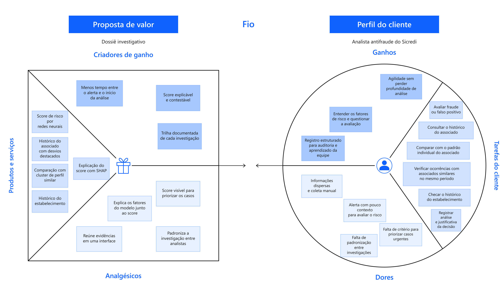

# 2. Canvas de Proposta de Valor

## Sumário

- [2.1 Introdução](#21-introducao)
- [2.2 A proposta de valor no contexto do Fio](#22-a-proposta-de-valor-no-contexto-do-fio)
- [2.3 Perfil do Cliente](#23-perfil-do-cliente)
  - [2.3.1 Tarefas do Cliente](#231-tarefas-do-cliente)
  - [2.3.2 Dores](#232-dores)
  - [2.3.3 Ganhos](#233-ganhos)
- [2.4 Mapa de Valor](#24-mapa-de-valor)
  - [2.4.1 Produtos e Serviços](#241-produtos-e-servicos)
  - [2.4.2 Analgésicos](#242-analgesicos)
  - [2.4.3 Criadores de Ganho](#243-criadores-de-ganho)
- [2.5 Conclusão](#25-conclusao)
- [Referências](#referencias)

---

## 2.1 Introdução

&emsp;O Canvas de Proposta de Valor organiza a relação entre as necessidades de um público e os produtos e serviços oferecidos para atendê-las (OSTERWALDER *et al.*, 2014). No Fio, ele apresenta como o dossiê investigativo pretende apoiar o analista antifraude do Sicredi na compreensão e no tratamento de transações suspeitas.

&emsp;O Perfil do Cliente descreve tarefas, dificuldades e ganhos esperados. O Mapa de Valor mostra as entregas da solução e como elas respondem a essas necessidades. O elemento central da proposta é reunir contexto e explicações em uma investigação organizada, com a decisão sob responsabilidade do profissional.

  Figura 2.1 - Canvas de Proposta de Valor do Fio
   
  
   
  Fonte: Elaboração própria (2026)

&emsp;A figura sintetiza a proposta completa do Fio. O [escopo da solução](escopo-proposta-solucao.md#33-o-que-esta-dentro-do-escopo) organiza as entregas da primeira versão, incluindo as condições para a comparação entre perfis semelhantes.

---

## 2.2 A proposta de valor no contexto do Fio

&emsp;O Fio foi concebido para o analista que precisa transformar uma transação suspeita em uma decisão fundamentada. Sua proposta de valor é reunir, em um dossiê, o histórico do associado, os indícios relevantes, a avaliação de risco e os fatores que contribuíram para essa avaliação.

&emsp;Com essas informações organizadas, o profissional terá apoio para compreender o caso, direcionar suas consultas e registrar a justificativa da decisão. A solução busca reduzir o esforço de preparação da investigação e facilitar a análise crítica dos indícios.

---

## 2.3 Perfil do Cliente

&emsp;O público prioritário é o analista de prevenção a fraudes do Sicredi. O canvas considera suas necessidades ao investigar uma transação suspeita: acessar contexto, interpretar sinais de risco, organizar prioridades e documentar o resultado da análise.

### 2.3.1 Tarefas do Cliente

&emsp;A tarefa central é avaliar se uma transação suspeita representa fraude ou um falso positivo — uma transação legítima sinalizada como suspeita — e fundamentar a decisão sobre o caso. Para isso, o fluxo considerado pelo Fio envolve:

- **Consultar o histórico do associado:** recuperar transações e acontecimentos relevantes para contextualizar a ocorrência.
- **Comparar com o padrão individual:** identificar se o comportamento atual está de acordo com o histórico ou apresenta desvios relevantes.
- **Verificar ocorrências com associados similares:** observar eventos em perfis semelhantes no mesmo período para ampliar a compreensão do caso.
- **Checar o histórico do estabelecimento:** examinar ocorrências anteriores e sua relação com a transação investigada.
- **Documentar a análise e a decisão:** registrar os indícios considerados e a justificativa adotada, permitindo consulta e revisão posteriores.

### 2.3.2 Dores

- **Esforço para reunir informações:** consultas separadas e cruzamentos manuais podem consumir parte do tempo disponível para interpretar o caso.
- **Dificuldade para compreender um alerta isolado:** uma indicação de suspeita exige contexto e explicações que ajudem a avaliar sua relevância para o associado.
- **Necessidade de priorizar a atenção:** casos com diferentes sinais de risco exigem critérios que apoiem a organização do trabalho.
- **Dificuldade para padronizar o registro:** evidências e justificativas apresentadas de maneiras diferentes dificultam a revisão e o compartilhamento das análises.

### 2.3.3 Ganhos

- **Agilidade com profundidade de análise:** encontrar as informações relevantes organizadas e dedicar mais atenção à interpretação dos indícios.
- **Clareza sobre os fatores de risco:** compreender a avaliação apresentada e ter elementos para confirmá-la, questioná-la ou contestá-la.
- **Rastreabilidade e aprendizado:** manter um registro da investigação que facilite a revisão das decisões e o compartilhamento de conhecimento.

---

## 2.4 Mapa de Valor

&emsp;O Mapa de Valor apresenta as capacidades propostas para responder às necessidades do analista. Elas se articulam em torno do dossiê investigativo, principal entrega da solução.

### 2.4.1 Produtos e Serviços

- **Dossiê investigativo:** visão organizada do caso, reunindo as informações necessárias à análise e ao registro da decisão.
- **Indicador de risco:** classificação calculada pela solução para apoiar a avaliação da transação e a organização da atenção entre casos.
- **Histórico do associado com desvios destacados:** sequência de transações que permita comparar a ocorrência com o comportamento individual.
- **Comparação com perfis semelhantes:** contexto sobre associados de comportamento similar e ocorrências no mesmo período, conforme as condições de entrega definidas no escopo.
- **Histórico do estabelecimento:** consulta a eventos anteriores relacionados ao ponto de venda envolvido.
- **Explicação dos fatores de risco:** apresentação compreensível dos elementos que contribuíram para a avaliação de risco do Fio.

### 2.4.2 Analgésicos

- **Consolidação das informações:** reunir histórico e evidências em uma interface para reduzir o esforço de preparação do caso.
- **Explicação integrada à análise:** apresentar os fatores de risco junto ao contexto da transação, facilitando a interpretação e o questionamento do resultado.
- **Apoio à priorização:** tornar o indicador de risco acessível durante a investigação, como um dos critérios de organização do trabalho.
- **Estrutura comum de registro:** organizar evidências, análise e justificativa em um formato que facilite a revisão e a continuidade da investigação.

### 2.4.3 Criadores de Ganho

- **Mais tempo dedicado à análise:** automatizar a organização de informações para que o profissional concentre seu esforço no entendimento do caso.
- **Maior transparência na avaliação:** relacionar o indicador de risco aos fatores e às evidências que ajudam a compreender o caso.
- **Conhecimento preservado:** manter o histórico da investigação e da justificativa humana disponível para consulta e aprendizado da equipe.

---

## 2.5 Conclusão

&emsp;A proposta de valor do Fio conecta as necessidades do analista a uma entrega central: um dossiê que torne a investigação mais organizada e compreensível.

| Necessidade do analista | Resposta proposta pelo Fio | Ganho esperado |
|---|---|---|
| Reunir o contexto do caso | Informações e evidências consolidadas | Mais agilidade para iniciar e aprofundar a investigação |
| Entender a indicação de risco | Fatores explicativos apresentados junto à transação | Mais clareza para avaliar e questionar o resultado |
| Organizar a atenção entre casos | Indicador de risco acessível | Apoio à priorização da análise |
| Fundamentar e revisar decisões | Registro estruturado de evidências e justificativa | Rastreabilidade e aprendizado da equipe |

&emsp;O benefício esperado está em apoiar uma decisão humana bem fundamentada. O indicador de risco, o histórico e as explicações compõem o contexto para o julgamento do profissional, enquanto o registro da investigação permite compreender como a decisão foi construída.

---

## Referências

OSTERWALDER, Alexander; PIGNEUR, Yves; BERNARDA, Greg; SMITH, Alan. **Value Proposition Design: how to create products and services customers want**. Hoboken: Wiley, 2014. Disponível em: [catálogo da editora](https://www.wiley.com/en-gb/value-proposition-design-how-to-create-products-and-services-customers-want-p-9781118968055). Acesso em: 27 out. 2026.
