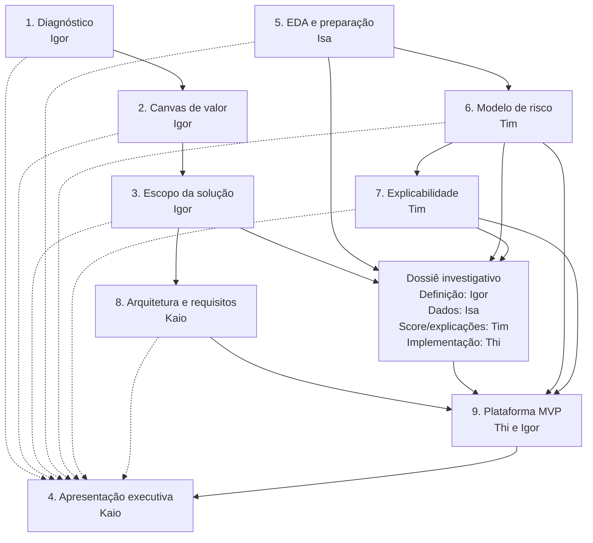

# Planejamento do Projeto Fio

> **Uso:** planejamento e acompanhamento interno da equipe.
>
> **Objetivo deste documento:** centralizar o escopo, os entregáveis, os responsáveis, os prazos, as dependências, os critérios de conclusão e a rotina de acompanhamento do projeto Fio.
>
> **Período planejado:** 26/10/2026 a 09/11/2026  
> **Duração:** 10 dias úteis de execução, considerando a pausa de 02/11/2026.  
> **Entrega final prevista:** 09/11/2026.  
> **Tipo de entrega:** MVP demonstrável, não uma plataforma pronta para produção.

> **Revisão de negócios:** 27/10/2026. As hipóteses internas H1–H4 e o protocolo de validação estão documentados; os resultados do MVP permanecem pendentes. A confirmação do contrato de entrega com a equipe está prevista para 28/10. Nenhuma meta ou avaliação abaixo deve ser apresentada como resultado já obtido.

---

<a id="1-visao-geral"></a>
## 1. Visão geral

O **Fio** é uma solução de apoio à investigação de fraudes. Seu papel começa depois que uma transação suspeita é identificada: a plataforma reúne contexto, evidências e histórico para ajudar o analista antifraude a investigar o caso com mais agilidade e consistência.

A solução deve combinar:

- Um **score de risco de fraude**, produzido por um modelo preditivo de Redes Neurais desenvolvido e treinado pela equipe com os dados disponibilizados para o case.
- A **explicabilidade do modelo**, para apresentar os fatores associados ao risco estimado.
- Um **dossiê investigativo**, que organiza o histórico do associado, desvios de comportamento, eventos relacionados e evidências disponíveis.
- Uma **plataforma MVP**, que apresenta essas informações ao analista e apoia sua avaliação.

O IBM Bob poderá apoiar o desenvolvimento do modelo e da aplicação, mas **não será o responsável por calcular o score em produção**. O score deverá ser gerado pelo modelo treinado pela equipe. A decisão final sobre a existência de fraude permanece humana: o score é um apoio à investigação, não uma confirmação definitiva.

<a id="11-objetivo-do-ciclo-de-10-dias"></a>
### 1.1 Objetivo do ciclo de 10 dias

Entregar uma demonstração funcional de ponta a ponta para pelo menos um caso, cobrindo o fluxo:

`Transação suspeita → score de risco → organização de evidências → dossiê investigativo → análise do profissional`

<a id="12-o-que-significa-concluir-o-projeto-neste-ciclo"></a>
### 1.2 O que significa concluir o projeto neste ciclo

Ao final do período, espera-se ter:

1. Os artefatos de Negócios documentados e coerentes com a solução construída.
2. Uma análise exploratória e uma base preparada para modelagem.
3. Um modelo candidato treinado, avaliado e capaz de produzir um score.
4. Uma primeira camada de explicabilidade vinculada ao modelo escolhido.
5. A arquitetura e os requisitos essenciais documentados.
6. Um MVP integrado e demonstrável, com as limitações conhecidas registradas.
7. Uma apresentação executiva alinhada aos resultados efetivamente obtidos.

**Limite de escopo:** o prazo não contempla garantir robustez de produção, operação em escala, implantação produtiva ou validação operacional extensa com analistas do Sicredi. O MVP deve priorizar um fluxo investigativo claro e confiável.

**Dados do case:** a base utilizada no projeto é sintética. A execução existente observou 160.000 registros, 297 colunas e 146 positivos; a diferença para as 900.000 linhas descritas nas orientações ainda precisa ser esclarecida. Os padrões observados nessa base não comprovam características da operação real do parceiro.

---

<a id="2-organizacao-do-trabalho"></a>
## 2. Organização do trabalho

O trabalho está dividido em duas frentes principais, com atividades paralelas:

- **Negócios:** entendimento do problema, proposta de valor, definição do escopo e apresentação executiva.
- **Plataforma:** dados e preparação, modelo preditivo, explicabilidade, arquitetura e implementação do MVP.


<figure style="text-align: center; margin: 0 auto; width: 80%;">
  <!-- Título acima da imagem -->
  <strong style="display: block; font-size: 1.0
  em; margin-bottom: 8px;">Figura 1: Diagrama de Correlação de Artefatos</strong>
  
  <!-- Imagem -->
  
  
  <!-- Legenda do autor abaixo da imagem -->
  <figcaption style="font-size: 0.9em; color: #555; margin-top: 5px;">
    Fonte: Autoria do grupo 
  </figcaption>
</figure>


<a id="21-responsaveis-por-artefato"></a>
### 2.1 Responsáveis por artefato

| ID | Artefato | Responsável principal | Colaboradores | Data de entrega |
|---|---|---|---|---|
| 1 | Diagnóstico do problema e da oportunidade | Igor | Time, quando necessário | 27/10/2026 |
| 2 | Canvas de Proposta de Valor | Igor | — | 28/10/2026 |
| 3 | Definição do escopo e da proposta da solução | Igor | Kaio, Tim e Thi para validação técnica | 28/10/2026 |
| 4 | Apresentação executiva do projeto | Kaio | Todos, fornecendo seus resultados | 09/11/2026 |
| 5 | Análise exploratória e preparação dos dados | Isa | Tim para alinhamento de modelagem | 29/10/2026 |
| 6 | Modelo preditivo de risco de fraude | Tim | Isa para dados preparados | 04/11/2026 |
| 7 | Camada de explicabilidade do modelo | Tim | Isa, quando necessário para interpretação das variáveis | 05/11/2026 |
| 8 | Arquitetura da plataforma e requisitos | Kaio | Igor e Thi; Tim para contratos de integração do modelo | 29/10/2026 |
| 9 | Plataforma de apoio à investigação (MVP) | Thi e Igor | Kaio, Isa e Tim, conforme as integrações | 06/11/2026 |

<a id="22-papeis-e-expectativas"></a>
### 2.2 Papéis e expectativas

| Pessoa | Responsabilidade central | Entregas-chave |
|---|---|---|
| **Igor** | Negócios e validação funcional do produto | Diagnóstico, Canvas, escopo, definição do dossiê e validação do MVP |
| **Kaio** | Arquitetura, requisitos e comunicação executiva | Arquitetura e requisitos; apresentação executiva |
| **Isa** | Entendimento, exploração e preparação dos dados | Relatório de EDA e base preparada para modelagem |
| **Tim** | Modelagem preditiva e explicabilidade | Modelo candidato, métricas, score e explicações |
| **Thi** | Implementação e integração do MVP | Interface, integração do modelo, exibição do dossiê e demonstração |

**Regra de responsabilidade:** o responsável principal garante a entrega; colaboradores fornecem insumos e revisões. Dependências e bloqueios devem ser comunicados assim que forem identificados, sem esperar a data final do artefato.

---

<a id="3-lista-de-entregaveis-e-macro-tarefas"></a>
## 3. Lista de entregáveis e macro tarefas

<a id="31-negocios"></a>
## 3.1 Negócios

### Artefato 1 — Diagnóstico do problema e da oportunidade

- **Responsável:** Igor
- **Prazo final:** 27/10/2026
- **Prioridade:** alta
- **Complexidade:** média
- **Objetivo:** documentar a dor do analista antifraude, o fluxo atual de investigação e a oportunidade de melhoria.

| Macro tarefa | Responsável | Prazo | Resultado esperado |
|---|---|---|---|
| Levantar o processo atual e os pontos de dificuldade da investigação após um alerta. | Igor | 26/10 | Descrição inicial do fluxo e dos principais gargalos. |
| Consolidar o problema, o usuário prioritário e a oportunidade. | Igor | 27/10 | Diagnóstico documentado, pronto para orientar o Canvas e o escopo. |

**Critérios de conclusão:**

- O usuário principal está claramente identificado.
- A dor e o gargalo que o Fio pretende resolver estão descritos.
- A oportunidade está centrada na investigação pós-alerta, e não apenas na detecção da fraude.
- O diagnóstico apresenta o problema e a oportunidade em linguagem de negócio. As fontes técnicas, hipóteses internas e pendências de validação ficam no material de apoio e neste planejamento.
- Os números citados podem ser conferidos no pacote de evidências; limitações e denominadores estão explícitos.

### Artefato 2 — Canvas de Proposta de Valor

- **Responsável:** Igor
- **Prazo final:** 28/10/2026
- **Prioridade:** alta
- **Complexidade:** média
- **Dependência:** diagnóstico do problema.

| Macro tarefa | Responsável | Prazo | Resultado esperado |
|---|---|---|---|
| Identificar tarefas, necessidades, dores e ganhos esperados do analista. | Igor | 27/10 | Necessidades do usuário estruturadas. |
| Relacionar funcionalidades do Fio às dores e aos ganhos esperados. | Igor | 28/10 | Proposta de valor conectada aos problemas identificados. |
| Revisar e consolidar o Canvas. | Igor | 28/10 | Canvas consistente e pronto para comunicação. |

**Critérios de conclusão:**

- As necessidades e dificuldades do usuário estão claras.
- Os benefícios propostos correspondem ao escopo do Fio.
- Não são prometidos resultados que ainda não foram demonstrados.
- As necessidades e benefícios do canvas estão relacionados às hipóteses internas e aos critérios de §7.2. O escopo apresenta em linguagem de negócio as condições da comparação por perfis semelhantes.

### Artefato 3 — Definição do escopo e da proposta da solução

- **Responsável:** Igor
- **Prazo final:** 28/10/2026
- **Prioridade:** crítica
- **Complexidade:** média/alta
- **Dependências:** diagnóstico, Canvas e alinhamento de viabilidade técnica com Kaio, Tim e Thi.

| Macro tarefa | Responsável | Prazo | Resultado esperado |
|---|---|---|---|
| Descrever o fluxo esperado da transação suspeita ao apoio à decisão humana. | Igor | 27/10 | Fluxo funcional descrito. |
| Priorizar as funcionalidades obrigatórias e definir o que ficará fora do MVP. | Igor, com o time | 28/10 | Escopo priorizado e exclusões registradas. |
| Definir limites do agente, papel do analista e critérios de aceite. | Igor, com Kaio, Tim e Thi | 28/10 | Escopo validado com a equipe técnica. |

**Critérios de conclusão:**

- Está definido o que o MVP fará e o que não fará.
- O score é tratado como indicador de risco, não como prova definitiva.
- A decisão final permanece com o analista.
- A estrutura do dossiê tem um conjunto mínimo de informações acordado.
- O contrato interno N1–N6 e o recurso condicionado C1 estão detalhados em [§7.1](#71-aceite-funcional-e-integridade-da-entrega) e correspondem às entregas apresentadas no escopo, com confirmação ou mudanças registradas pelo time.
- Os critérios distinguem aceite funcional do protótipo e avaliação exploratória do valor entregue.

**Marco obrigatório:** congelar o escopo em 28/10. Qualquer funcionalidade nova após essa data precisa substituir outra ou ser adiada.

### Artefato 4 — Apresentação executiva do projeto

- **Responsável:** Kaio
- **Prazo final:** 09/11/2026
- **Prioridade:** alta
- **Complexidade:** média
- **Dependências:** resultados de Negócios, Dados/IA, arquitetura e MVP.

| Macro tarefa | Responsável | Prazo | Resultado esperado |
|---|---|---|---|
| Definir a narrativa e a estrutura da apresentação. | Kaio | 29/10 | Roteiro e sequência de slides definidos. |
| Montar os slides de problema, proposta de valor, escopo e arquitetura. | Kaio | 03/11 | Primeira versão da apresentação. |
| Incorporar resultados reais do modelo, explicabilidade e MVP. | Kaio, com insumos do time | 06/11 | Apresentação atualizada com evidências da solução. |
| Revisar, ensaiar a demonstração e finalizar. | Kaio e time | 09/11 | Material final revisado e pronto para apresentação. |

**Critérios de conclusão:**

- Problema, valor, arquitetura e demonstração contam uma história coerente.
- Métricas e resultados apresentados correspondem aos experimentos realizados.
- Limitações conhecidas são explicitadas.
- A demonstração foi ensaiada com o fluxo final disponível.

<a id="32-plataforma"></a>
## 3.2 Plataforma

### Artefato 5 — Análise exploratória e preparação dos dados

- **Responsável:** Isa
- **Prazo final:** 29/10/2026
- **Prioridade:** crítica
- **Complexidade:** alta
- **Dependência:** acesso aos dados disponibilizados para o case.

| Macro tarefa | Responsável | Prazo | Resultado esperado |
|---|---|---|---|
| Mapear arquivos, colunas, tipos de dados e variável-alvo. | Isa | 26/10 | Inventário inicial dos dados e verificação da variável-alvo. |
| Avaliar qualidade, dados ausentes, duplicidades, distribuições e desbalanceamento. | Isa | 27/10 | Relatório inicial de qualidade e achados exploratórios. |
| Tratar dados e preparar conjuntos de treino e teste, evitando vazamento de dados. | Isa | 28/10 | Pipeline/base de preparação documentado. |
| Entregar a base preparada e o resumo da EDA para modelagem. | Isa | 29/10 | Insumos utilizáveis por Tim e limitações conhecidas documentadas. |

**Critérios de conclusão:**

- As colunas e seus significados conhecidos estão documentados.
- A disponibilidade e a qualidade da variável-alvo estão verificadas.
- Dados ausentes, duplicidades, desbalanceamento e limitações relevantes estão documentados.
- A preparação é reproduzível e respeita a separação entre treino e teste.
- As janelas históricas e os atributos usam somente informação disponível no instante do caso; o corte temporal, o suporte de rótulos por partição e os possíveis vazamentos estão registrados.
- Tim recebeu os dados e informações necessários para iniciar/continuar a modelagem.

**Regra de contingência:** caso não exista uma variável-alvo adequada, Isa deve comunicar isso imediatamente a Tim e ao time. A equipe deverá reavaliar o plano de modelagem; não se deve presumir que o treinamento supervisionado será viável antes de verificar os dados.

### Artefato 6 — Modelo preditivo de risco de fraude

- **Responsável:** Tim
- **Prazo final:** 04/11/2026
- **Prioridade:** crítica
- **Complexidade:** muito alta
- **Dependência:** dados preparados e variável-alvo utilizável.

| Macro tarefa | Responsável | Prazo | Resultado esperado |
|---|---|---|---|
| Definir pipeline de treino, estratégia de avaliação e métricas adequadas. | Tim | 28/10 | Abordagem de modelagem e critérios de avaliação documentados. |
| Treinar a primeira versão com a base preliminar disponível. | Tim | 30/10 | Modelo inicial e resultados preliminares. |
| Comparar/ajustar candidatos e selecionar a versão a integrar. | Tim | 04/11 | Modelo candidato escolhido, com métricas e limitações. |
| Disponibilizar artefato e contrato de entrada/saída para integração. | Tim | 04/11 | Modelo capaz de gerar um score para a entrada definida. |

**Critérios de conclusão:**

- O modelo foi treinado com dados do case e possui pipeline identificável/reproduzível.
- **Estratégia de particionamento (decisão D2, 29/10/2026):** somente os registros de jan–mar/2025 possuem `feedback_label` confirmado (116 positivos). A avaliação usa **validação cruzada estratificada** sobre esse período. Registros de meses posteriores são usados para inferência (geração de score em produção/demonstração), sem avaliação de qualidade por ausência de rótulos. Esta limitação deve constar no model card.
- A avaliação reporta PR-AUC (métrica principal dado o desbalanceamento de 0,088%), precisão e recall no corte definido, com referência de comparação. Acurácia isolada não atende esse critério.
- Para H3, Tim define antes do teste a capacidade de análise `k` ou um corte de score e registra a métrica de ordenação correspondente, junto à referência de comparação. O conjunto de validação é o período jan–mar/2025.
- **Features dos scores externos (decisão D1, 29/10/2026):** `fraud_score`, `visa_fraud_score` e `mc_fraud_score` são incluídos como features. A premissa de disponibilidade no momento da autorização deve ser declarada explicitamente no model card como limitação de validação com dados sintéticos.
- Os 6 casos de demonstração são reservados **antes** do split de treino/validação (decisão D7). Tim recebe os índices reservados por Igor e Isa e os exclui do treino.
- A separação entre treino e validação evita vazamento de dados; campos de resultado posterior (`decision=deny`, `transaction_status=declined`, `fraud`) são excluídos como features.
- O score pode ser gerado para uma transação/caso no formato acordado com a plataforma.
- Métricas, versão selecionada, limitações e premissas estão documentadas.
- O score é descrito como risco estimado; interpretação como probabilidade calibrada depende de avaliação específica.

**Plano de contingência:** disponibilizar uma versão candidata funcional até 30/10 para permitir que Thi avance com a integração. A otimização deve terminar em 04/11; depois disso, mudanças no modelo só devem ocorrer se houver erro crítico ou ganho justificado que não comprometa a integração.

### Artefato 7 — Camada de explicabilidade do modelo

- **Responsável:** Tim
- **Prazo final:** 05/11/2026
- **Prioridade:** alta
- **Complexidade:** alta
- **Dependência:** modelo candidato e compreensão das variáveis.

| Macro tarefa | Responsável | Prazo | Resultado esperado |
|---|---|---|---|
| Definir método de explicabilidade e formato de saída para o MVP. | Tim | 03/11 | Método e estrutura de explicação definidos. |
| Gerar explicações globais e explicações para casos representativos. | Tim | 04/11 | Fatores relevantes associados às previsões identificados. |
| Validar interpretação e entregar saídas para integração. | Tim | 05/11 | Explicações prontas para apresentação no dossiê. |

**Critérios de conclusão:**

- A explicabilidade corresponde à versão do modelo selecionada.
- A aplicação consegue consumir a saída em um formato definido.
- A explicação ajuda a entender os fatores associados ao score.
- As explicações não são descritas como prova de fraude nem como causalidade sem evidência.
- Limitações de interpretação estão registradas.
- O método SHAP, a saída explicada, a referência de comparação e a ligação entre entrada, score e versão do modelo estão documentados. A compreensão pelo participante será avaliada no ensaio de §7.2.

### Artefato 8 — Arquitetura da plataforma e requisitos

- **Responsável:** Kaio
- **Prazo final:** 29/10/2026
- **Prioridade:** crítica
- **Complexidade:** alta
- **Dependências:** escopo inicial e alinhamento com Igor, Tim e Thi.

| Macro tarefa | Responsável | Prazo | Resultado esperado |
|---|---|---|---|
| Levantar e priorizar requisitos funcionais e o fluxo de uso. | Kaio | 27/10 | Lista de requisitos prioritários. |
| Desenhar componentes, fluxo de dados e contratos de integração. | Kaio | 28/10 | Arquitetura preliminar e interfaces entre componentes. |
| Documentar arquitetura, premissas, requisitos técnicos e critérios de aceite. | Kaio | 29/10 | Documento que permita a implementação sem decisões estruturais tardias. |

**Critérios de conclusão:**

- Os principais componentes e suas responsabilidades estão descritos.
- O fluxo entre entrada, score, explicabilidade, dossiê e interface está claro.
- Os contratos de entrada e saída estão acordados com Tim e Thi.
- Requisitos funcionais e critérios mínimos do MVP estão priorizados.
- A arquitetura mapeia N1–N6 e C1 aos componentes, incluindo registro da análise humana, recuperação das evidências e rastro das consultas adaptativas.
- Premissas, dependências e limitações estão documentadas.

**Orientação:** a arquitetura precisa estar suficientemente definida até 29/10. O Thi pode iniciar a interface com dados simulados antes disso, sem esperar a documentação completa.

### Artefato 9 — Plataforma de apoio à investigação (MVP)

- **Responsáveis:** Thi e Igor
- **Prazo final:** 06/11/2026
- **Prioridade:** crítica
- **Complexidade:** muito alta
- **Dependências:** escopo, arquitetura, score, explicabilidade e conteúdo do dossiê.

| Macro tarefa | Responsável | Prazo | Resultado esperado |
|---|---|---|---|
| Definir fluxo principal, campos e informações mínimas do dossiê. | Igor, com Thi | 29/10 | Especificação funcional do dossiê. |
| Implementar interface e fluxo principal com dados simulados, se necessário. | Thi | 03/11 | Interface navegável sem depender do modelo final. |
| Integrar score do modelo e validar contrato de entrada/saída. | Thi, com Tim | 05/11 | Aplicação apresenta o score gerado pelo modelo. |
| Integrar explicações, histórico e evidências disponíveis ao dossiê. | Thi, com Igor e apoio de Isa/Tim | 06/11 | Visão investigativa organizada para um caso. |
| Testar o fluxo completo, corrigir falhas críticas e preparar a demonstração. | Thi e Igor | 06/11 | MVP demonstrável de ponta a ponta. |
| Preparar casos pareados, gabarito de evidências e rubrica; fixar o desenho do protocolo antes da coleta. | Igor, com Isa e Tim | 30/10 | Casos, gabarito, rubrica e desenho comparativo versionados; versões finais de modelo e explicações congeladas até 05/11. |
| Executar o ensaio comparativo e consolidar seus resultados ou impedimentos. | Igor, com Thi | 06/11 | Tempos, completude, rubricas, rastros e limitações registrados; sem alegar validação operacional com participantes internos. |

**Conteúdo mínimo recomendado para o dossiê:**

- Identificação da transação/caso, usando os campos disponíveis nos dados.
- Score de risco gerado pelo modelo.
- Histórico ou contexto do associado disponível nos dados.
- Desvios relevantes em relação aos padrões que puderem ser calculados com os dados existentes.
- Eventos relacionados e evidências encontradas, quando disponíveis.
- Fatores associados ao score e explicação compreensível.
- Indicação clara de que o resultado é apoio à investigação e exige avaliação humana.
- Histórico do estabelecimento com janela e suporte, ou motivo de indisponibilidade; comparação por cluster conforme a decisão de C1.
- Registro salvável e recuperável da análise e justificativa, caso, evidências, momento de geração e versão do modelo.
- Rastro da ordem e do motivo das consultas e das lacunas encontradas.

**Critérios de conclusão:**

- É possível percorrer o fluxo central da aplicação.
- O MVP apresenta o score efetivamente calculado pela versão candidata identificada. Uma tela com score mockado não cumpre N1.
- As explicações e os dados do dossiê correspondem ao caso demonstrado.
- Dados simulados usados em desenvolvimento estão identificados e não são apresentados como resultados reais.
- Falhas conhecidas e limitações da demonstração estão registradas.
- A decisão final continua com o analista; o sistema não confirma fraude nem bloqueia cartões automaticamente.
- O núcleo N1–N6 atende aos critérios internos de §7.1 e há decisão registrada sobre C1. No mínimo, os testes cobrem duas rotas justificadas e um cenário de contexto insuficiente.
- O resultado do protocolo de §7.2, ou a razão de sua execução incompleta, está documentado separadamente do aceite funcional.

---

<a id="4-diagrama-de-dependencias"></a>
## 4. Diagrama de dependências

O diagrama mostra o caminho de dependências entre os artefatos. As setas indicam que a entrega de origem fornece informação ou componente necessário à etapa seguinte. Algumas atividades podem começar em paralelo com versões preliminares.



<a id="41-dependencias-criticas"></a>
### 4.1 Dependências críticas

1. **Isa → Tim:** a base preparada e o diagnóstico da variável-alvo viabilizam uma modelagem apropriada.
2. **Tim → Thi:** o score e o contrato de integração precisam estar disponíveis para integrar o modelo real.
3. **Tim → explicabilidade → Thi:** as explicações precisam corresponder à versão escolhida e ser fornecidas em formato consumível pela aplicação.
4. **Igor → Thi:** o conteúdo mínimo do dossiê e os critérios funcionais devem ser definidos cedo para evitar retrabalho na interface.
5. **Kaio → Thi:** a arquitetura e os contratos de integração devem estar definidos até 29/10.
6. **Todas as frentes → Kaio:** a versão final da apresentação depende dos resultados reais e da demonstração integrada.

---

<a id="5-calendario-de-execucao"></a>
## 5. Calendário de execução

O calendário considera 02/11/2026 como dia sem execução. O planejamento, portanto, distribui os dez dias de trabalho da seguinte forma:

| Dia de projeto | Data | Foco principal | Marco/resultado esperado |
|---|---|---|---|
| D1 | Seg. 26/10 | Diagnóstico; início da EDA; inventário dos dados; requisitos iniciais | Problema e estrutura dos dados começando a ser compreendidos |
| D2 | Ter. 27/10 | Finalizar diagnóstico; necessidades do usuário; análise inicial dos dados; requisitos | Diagnóstico entregue; riscos iniciais de dados identificados |
| D3 | Qua. 28/10 | Canvas; congelamento do escopo; preparação dos dados; estratégia do modelo; arquitetura preliminar | Contrato N1–N6/C1 e protocolo de validação confirmados ou alterações registradas pelo time |
| D4 | Qui. 29/10 | Entrega da EDA; entrega da arquitetura; especificação do dossiê; estrutura da apresentação | Dados e contratos técnicos disponíveis |
| D5 | Sex. 30/10 | Treino inicial; interface com dados simulados; preparação dos casos e rubrica | Modelo inicial e interface navegável; materiais e critérios do ensaio fixados antes da coleta |
| — | Seg. 02/11 | **Sem execução planejada — Finados** | — |
| D6 | Ter. 03/11 | Início da segunda semana; refinamento da apresentação; implementação do MVP; método de explicabilidade | Interface e narrativa avançando em paralelo |
| D7 | Qua. 04/11 | Seleção do modelo candidato; geração de explicações; integração do score | Modelo candidato entregue |
| D8 | Qui. 05/11 | Entrega da explicabilidade; integração de score e explicações; revisão funcional | Saídas de IA disponíveis e versões finais do modelo e das explicações congeladas para o ensaio |
| D9 | Sex. 06/11 | Integração do dossiê; aceite funcional; ensaio comparativo; correções | Resultados funcionais e exploratórios separados, com impedimentos e limitações registrados |
| D10 | Seg. 09/11 | Ensaio, revisão final e apresentação | Apresentação e pacote final entregues |

---

<a id="6-marcos-de-controle"></a>
## 6. Marcos de controle

| Marco | Data | Evidência de conclusão | Ação se não for atingido |
|---|---|---|---|
| M1 — Diagnóstico concluído | 27/10 | Documento de diagnóstico | Igor prioriza a versão mínima necessária para destravar o Canvas. |
| M2 — Escopo congelado | 28/10 | Contrato N1–N6/C1 e protocolo de §7.2 confirmados ou mudanças registradas pelo time | Adiar recursos condicionados inviáveis; registrar qualquer redução do núcleo, sem declará-lo integralmente entregue. |
| M3 — Dados e arquitetura disponíveis | 29/10 | Base preparada/relatório EDA e documento de arquitetura/contratos | Comunicar bloqueios imediatamente e reduzir integrações necessárias ao MVP. |
| M4 — Modelo inicial disponível | 30/10 | Primeiro treino e resultado preliminar | Thi continua com interface simulada; Tim prioriza o caminho mínimo para um modelo candidato. |
| M5 — Modelo candidato selecionado | 04/11 | Artefato do modelo, score e métricas | Congelar versão viável com limitações explícitas; evitar novas frentes de otimização. |
| M6 — Explicabilidade integrada | 05/11 | Saída de explicação consumida pela aplicação | Reduzir a apresentação da explicação ao formato mínimo tecnicamente defensável. |
| M7 — MVP integrado | 06/11 | Verificação N1–N6, situação de C1 e registro do ensaio de §7.2 | Demonstrar o que funciona, identificar requisitos não atendidos e resultados inconclusivos; uma demonstração parcial não equivale ao aceite integral. |
| M8 — Entrega final | 09/11 | Apresentação revisada e demonstração ensaiada | Corrigir primeiro falhas que impeçam a demonstração ou produzam afirmações incorretas. |

---

<a id="7-criterios-de-aceite-globais"></a>
## 7. Critérios de aceite globais

O aceite funcional e a avaliação de valor devem ser registrados separadamente. Os requisitos internos de §7.1 detalham as entregas apresentadas no escopo e devem ser confirmados com o time até 28/10; mudanças precisam preservar a rastreabilidade entre diagnóstico, canvas, escopo e planejamento.

<a id="71-aceite-funcional-e-integridade-da-entrega"></a>
### 7.1 Aceite funcional e integridade da entrega

**Contrato interno de entrega:** os identificadores abaixo são usados pela equipe para verificar as capacidades descritas no documento de escopo.

| ID | Entrega | Prioridade no ciclo | Critério de aceite |
|---|---|---|---|
| N1 | Score por rede neural treinada com a base do case | Obrigatória | Inferência da versão identificada; métricas por **validação cruzada estratificada sobre jan–mar/2025** (únicos meses com rótulos confirmados — EDA) e referência de comparação documentadas; score tratado como risco estimado. Meses posteriores usados apenas para inferência. Features `fraud_score`, `visa_fraud_score`, `mc_fraud_score` incluídas com premissa de disponibilidade declarada no model card. (Decisões D1 e D2, 29/10/2026) |
| N2 | Explicação do score com SHAP | Obrigatória | Explicação vinculada ao mesmo caso, entrada e versão de N1, com método e limitações registrados. |
| N3 | Histórico do associado e desvios calculáveis | Obrigatória | Consultar histórico anterior disponível; demonstrar um caso com histórico e outro sem suporte suficiente, informando as limitações. |
| N4 | Histórico do estabelecimento | Obrigatória | Consultar eventos anteriores pelo identificador disponível, informar janela e suporte e distinguir ausência de registros de evidência de baixo risco. |
| N5 | Dossiê e registro da análise humana | Obrigatória | Apresentar N1–N4 e permitir salvar e recuperar análise e justificativa, identificação do caso, evidências, momento de geração e versão do modelo. |
| N6 | Organização adaptativa limitada da investigação | Obrigatória | Demonstrar duas rotas de consulta distintas e justificadas pelos indícios e um cenário de contexto insuficiente; preservar o rastro das etapas e fontes consultadas. |
| C1 | Comparação com cluster de perfil similar e ocorrências no mesmo período | **Não entregue neste ciclo** (decisão D4, 29/10/2026) | C1 declarado indisponível. O dossiê exibe `cluster_comparison_status = "nao_entregue_neste_ciclo"`. Canvas mantém a funcionalidade como valor futuro. Nenhuma implementação de clustering neste ciclo. |

O núcleo do MVP poderá ser considerado funcionalmente concluído quando:

- [ ] Os artefatos de Negócios estão documentados e coerentes entre si.
- [ ] A EDA documenta estrutura, qualidade, variável-alvo e limitações dos dados.
- [ ] Há um modelo candidato treinado, avaliado e capaz de produzir um score para o caso de demonstração.
- [ ] A explicabilidade está associada à versão selecionada do modelo e possui limitações registradas.
- [ ] A arquitetura descreve o fluxo e os contratos principais de integração.
- [ ] O dossiê reúne as informações disponíveis relevantes para um caso, sem inventar evidências ausentes.
- [ ] A plataforma demonstra o fluxo principal de ponta a ponta.
- [ ] Análise e justificativa humanas, evidências, caso, momento de geração e versão do modelo podem ser salvos e recuperados.
- [ ] Duas rotas de consulta distintas e justificadas e um cenário de contexto insuficiente atendem N6, com rastro de execução.
- [ ] A situação de C1 está registrada; cluster indisponível não é contabilizado como comparação entregue.
- [ ] A base sintética do case, os dados mockados para a interface e as saídas efetivamente calculadas estão diferenciados.
- [ ] A apresentação utiliza apenas métricas e resultados que foram efetivamente medidos.
- [ ] Está explícito que o score não comprova fraude e que a decisão final é humana.

**Falhas críticas:** evidência inventada, informação de outro caso, uso de dados posteriores como se estivessem disponíveis, explicação incompatível com o modelo ou ação operacional autônoma impedem o aceite do núcleo até correção. A ausência de histórico, corretamente identificada, não deve ser confundida com risco baixo. A verificação deverá registrar resultado e evidência para cada item N1–N6, incluindo um caso com histórico anterior verificável.

Uma entrega parcial poderá ser apresentada com seus requisitos não atendidos. Resultado de valor inconclusivo ou desfavorável não é falha de integridade quando documentado; impede, porém, alegar benefício validado.

<a id="72-protocolo-de-validacao-do-valor-do-mvp"></a>
### 7.2 Protocolo de validação do valor do MVP

**Estado:** planejado, sem resultados registrados nesta revisão. O ensaio é exploratório e avalia a organização e apresentação do dossiê. A qualidade preditiva é avaliada à parte por Tim no conjunto temporal de teste. As hipóteses abaixo organizam a verificação interna dos benefícios apresentados no diagnóstico e no canvas. Seus identificadores e estados de acompanhamento ficam neste planejamento.

**Hipóteses internas de avaliação**

| ID | Hipótese da equipe | Evidência disponível e limite | Como validar |
|---|---|---|---|
| H1 | A coleta dispersa de evidências exige esforço que pode ser reduzido com um dossiê único. | A base contém entidades e histórico para simular a coleta; não há medição do esforço na operação do parceiro. | Confirmar o fluxo com profissional do domínio e comparar tempo e completude com e sem o Fio. |
| H2 | Fatores explicativos do score ajudam a avaliar e questionar a hipótese de risco. | O escopo prevê SHAP; sua compreensão por usuários ainda não foi avaliada. | Pedir ao participante que relacione fatores às evidências, explique limites do score e registre uma justificativa, usando rubrica previamente definida. |
| H3 | Um score útil oferece um critério adicional para priorização. | Existem rótulos sintéticos; não há comprovação de ordenação útil nem de urgência operacional real. | Avaliar a ordenação no conjunto temporal de teste, com métrica e capacidade de análise fixadas antes do teste; observar se o participante compreende esse uso. |
| H4 | Uma estrutura comum de investigação reduz omissões e melhora a rastreabilidade. | O produto prevê campos comuns e registro da decisão; não há comparação entre investigações concluídas. | Comparar completude e qualidade das justificativas e verificar a recuperação do registro do caso, da versão do modelo e das evidências utilizadas. |

**Preparação e controle da comparação**

1. Igor consolida com Isa e Tim, até 30/10, pelo menos **seis casos sintéticos distintos**, organizados em três pares de dificuldade semelhante. A seleção deve cobrir histórico disponível e insuficiente e as duas rotas de investigação; registrar os critérios de seleção sem privilegiar acertos do modelo. **Os índices dos 6 casos (positivos) devem ser reservados antes que Tim realize o split de treino/validação (decisão D7, 29/10/2026)** — Tim exclui esses índices do conjunto de treino para evitar contaminação. O conjunto disponível tem 116 positivos, todos em jan–mar/2025; reservar 6 reduz o treino para 110 positivos (impacto mínimo).
2. Para cada caso, preparar antes das respostas um gabarito de evidências relevantes e disponíveis no instante analisado, com fontes e janelas. Evidência indisponível fica identificada e fora do denominador de completude, sem alterar o gabarito depois de observar os resultados. O rótulo de desfecho e dados posteriores ficam ocultos aos participantes.
3. Fixar casos, gabarito, rubrica e desenho comparativo até 30/10. Até 05/11, após selecionar o modelo e integrar a explicabilidade, congelar suas versões finais e as saídas usadas nas duas condições, antes de iniciar a coleta. Preparar instruções iguais e um caso de treino separado do conjunto avaliado. Registrar mudanças e reiniciar a comparação afetada se uma correção alterar seu material.
4. Convidar pelo menos **dois participantes**, registrando experiência com o domínio e com o protótipo por códigos de participante. Sem analistas antifraude, caracterizar a execução como ensaio interno de uso, com validade limitada. Um revisor diferente do autor de cada resposta aplica a rubrica; se houver dois revisores, registrar e resolver as divergências.
5. Comparar a condição **A — referência**, com fontes, score e fatores explicativos em tabelas, com a condição **B — Fio**, que organiza as mesmas informações no dossiê. Manter dados, tarefas e ambiente equivalentes. O ensaio mede o efeito da organização e apresentação; não isola nem comprova o ganho do modelo preditivo.
6. Distribuir os casos dos pares entre A e B e inverter a distribuição e a ordem entre participantes. Cada participante analisa os seis casos uma única vez, em condições alternadas. Registrar a sequência para reduzir aprendizado e efeito de ordem; os casos pareados não são necessariamente idênticos em dificuldade.
7. Iniciar a contagem na abertura do caso. Registrar o momento em que as evidências mínimas foram reunidas e o momento do envio da análise e justificativa. Incluir esperas da aplicação no tempo total e registrar separadamente seu processamento, bem como falhas e interrupções.

**Métricas e interpretação previstas**

| Hipótese | Medida | Critério para interpretar o ensaio |
|---|---|---|
| H1 — Redução de esforço de coleta | Tempo de coleta e tempo total por caso; completude e qualidade da justificativa | Indício favorável se a mediana do tempo total com Fio for menor que na referência, sem redução das medianas de completude e qualidade. Reportar também as diferenças por par e participante. |
| H2 — Compreensão e contestação do risco | Dimensão de interpretação do score na rubrica e justificativa registrada | Indício favorável se a mediana dessa dimensão melhorar em B, sem queda da qualidade total. Distinguir entendimento do modelo de concordância com o score. |
| H3 — Apoio à priorização | Métrica de ordenação no teste temporal do modelo, com `k` ou corte fixado previamente, suporte e referência registrados | Relatar a comparação quantitativa com a referência; poucos positivos ou métrica indefinida limitam a conclusão. No ensaio de uso, observar compreensão do score; seis casos não validam urgência operacional. |
| H4 — Padronização e rastreabilidade | Completude, qualidade da justificativa e recuperação do registro do caso | A recuperação do registro é um aceite funcional. Redução de omissões exige melhora da completude no ensaio, sem queda da qualidade. A padronização da estrutura não implica decisões idênticas entre pessoas. |

**Completude:** número de evidências relevantes corretamente recuperadas dividido pelo número de evidências relevantes disponíveis no gabarito fixado. Informar numerador, denominador e quantidade de itens indisponíveis. Casos sem evidências disponíveis ficam com completude não definida e são reportados separadamente.

**Rubrica de qualidade da justificativa:** atribuir, em cada dimensão, `0` para ausente ou incorreta, `1` para parcial e `2` para clara e consistente com o caso, totalizando de 0 a 8 pontos:

- Uso de evidências verificáveis e relação com a conclusão.
- Interpretação do score e dos fatores explicativos, incluindo possibilidade de contestação.
- Reconhecimento de ausências, incertezas e limites da explicação.
- Clareza da análise e justificativa da decisão humana.

O revisor deverá avaliar respostas sem identificação de condição ou participante quando o formato permitir; limitações de ocultação devem ser registradas. Evidência inventada não pode ser compensada por pontuação alta em outras dimensões e exige investigação da falha funcional.

**Registro e conclusão:** até 06/11, Igor consolida número de participantes e casos por condição, perfil dos participantes, sequência aplicada, versões, exclusões e motivos, tempos, medianas e dispersão, completude, rubricas e rastros de recuperação. Classificar cada hipótese como **indício favorável no ensaio**, **indício desfavorável** ou **inconclusiva**, justificando o resultado. Metas adicionais devem ser fixadas antes da coleta e nunca escolhidas para acomodar os resultados.

Se o mínimo de casos ou participantes não for alcançado, ou se a comparação não puder ser executada, registrar **avaliação de valor incompleta/inconclusiva**, com motivo e próximo passo. O tamanho reduzido e o uso de casos artificiais não permitem alegar significância estatística, benefício generalizável ou validação operacional no Sicredi. Antes de uma conclusão sobre a operação real, será necessário confirmar o processo, os critérios e as condições de uso com profissionais do domínio e avaliar casos representativos desse ambiente.

---

<a id="8-riscos-mitigacao-e-plano-de-contingencia"></a>
## 8. Riscos, mitigação e plano de contingência

| Risco | Impacto | Mitigação | Responsável por monitorar |
|---|---|---|---|
| Variável-alvo ausente, inconsistente ou inadequada | Pode inviabilizar o treino supervisionado planejado | Verificar a variável-alvo no D1 e comunicar qualquer bloqueio imediatamente | Isa e Tim |
| Dados de baixa qualidade ou volume insuficiente | Métricas pouco confiáveis ou preparação mais demorada | Priorizar diagnóstico, documentar limitações e reduzir escopo experimental | Isa |
| Modelo não atingir qualidade útil no prazo | Integração e narrativa de resultados ficam comprometidas | Criar versão inicial até 30/10, usar métricas apropriadas e congelar o candidato até 04/11 | Tim |
| Sobrecarga do Igor com Negócios e MVP | Atrasos no escopo e na validação funcional | Congelar escopo até 28/10 e reservar Igor para definir dossiê e validar comportamentos | Igor e Thi |
| Contratos técnicos definidos tarde | Retrabalho na interface e integração | Kaio documenta contratos até 29/10; Thi desenvolve interface com mocks antes disso | Kaio e Thi |
| Integração entre modelo e plataforma falhar | MVP incompleto | Definir formato de entrada/saída cedo, testar integração isoladamente e manter caso de demonstração controlado | Tim e Thi |
| Explicações serem difíceis de interpretar | Dossiê perde utilidade ou induz conclusões erradas | Usar explicações vinculadas ao modelo, texto claro e ressalvas sobre associação/causalidade | Tim e Igor |
| Aumento de escopo durante a execução | Risco de não concluir o fluxo principal | Congelar escopo em 28/10 e exigir substituição de escopo para qualquer adição | Igor e todo o time |
| Demonstração final depender de dados indisponíveis | Apresentação instável | Preparar caso de demonstração previamente, registrar procedência dos dados e distinguir dados simulados | Thi e Kaio |
| Não haver acesso a analistas do domínio | Necessidades e utilidade operacional permanecem sem confirmação | Registrar tentativas e disponibilidade; realizar ensaio interno quando possível e limitar explicitamente suas conclusões | Igor |
| Confundir padrões sintéticos com evidência da operação real | Diagnóstico ou apresentação podem atribuir ao parceiro conclusões sem suporte | Identificar a natureza da base, usar o pacote de evidências e separar hipóteses, observações e resultados do MVP | Igor e Isa |
| Comparação contaminada por aprendizado ou escolha favorável de casos | Medidas de tempo e qualidade podem ficar enviesadas | Congelar materiais, usar pares, alternar condições e registrar ordem, exclusões e alterações | Igor e Thi |

<a id="81-prioridades-em-caso-de-atraso"></a>
### 8.1 Prioridades em caso de atraso

Se houver atraso, a ordem de prioridade deverá ser:

1. Garantir uma base compreendida e um modelo candidato com avaliação honesta.
2. Garantir o contrato de integração e o núcleo investigativo N1–N6; qualquer redução deve ser registrada como entrega parcial.
3. Garantir score, explicações, histórico e seu tratamento de ausências, registro humano e rastros, sem inventar evidências.
4. Registrar a situação de C1 e do ensaio de valor e finalizar os documentos e a apresentação com base nos resultados obtidos.
5. Adiar melhorias visuais, funcionalidades secundárias e otimizações que não sejam necessárias para demonstrar o valor central.

---

<a id="9-rotina-de-acompanhamento"></a>
## 9. Rotina de acompanhamento

<a id="91-check-in-diario"></a>
### 9.1 Check-in diário

Recomenda-se um alinhamento curto diário, com foco em dependências e desbloqueios. Cada responsável deve informar:

1. O que foi concluído desde o último alinhamento.
2. Qual é a próxima entrega concreta e em que data.
3. Se existe bloqueio, dependência ou risco para outra pessoa.
4. Se alguma entrega ou prazo precisa ser renegociado.

<a id="92-atualizacao-do-status"></a>
### 9.2 Atualização do status

Cada macro tarefa deve receber um destes status no quadro do projeto:

- `Não iniciada`
- `Em andamento`
- `Bloqueada`
- `Em revisão`
- `Concluída`

Uma tarefa só deve ser marcada como **Concluída** quando houver um artefato verificável — documento, código, modelo, resultado, interface ou demonstração — e os critérios de conclusão aplicáveis forem atendidos.

<a id="93-controle-de-mudancas"></a>
### 9.3 Controle de mudanças

Após o marco de escopo congelado em 28/10:

- Toda nova funcionalidade deve ser classificada como obrigatória ou desejável.
- Uma nova funcionalidade obrigatória precisa substituir outra de esforço comparável ou receber aprovação explícita do time.
- Mudanças que alterem o contrato de integração devem ser comunicadas imediatamente a Kaio, Tim e Thi.
- Não se deve ampliar o escopo silenciosamente perto da integração final.

---

<a id="10-registro-de-decisoes-e-pendencias"></a>
## 10. Registro de decisões e pendências

Use esta seção para manter decisões relevantes visíveis para toda a equipe.

| Data | Decisão ou pendência | Responsável | Status |
|---|---|---|---|
| 26/10/2026 | Confirmar disponibilidade e significado da variável-alvo de fraude. | Isa e Tim | A verificar |
| 26/10/2026 | Definir campos mínimos disponíveis para o dossiê. | Igor, Isa e Tim | Em aberto |
| 27/10/2026 | Confirmar formato de entrada/saída do modelo para a plataforma. | Tim, Kaio e Thi | Em aberto |
| 28/10/2026 | Congelar escopo do MVP e seus critérios de aceite. | Igor e time | Planejado |
| 29/10/2026 | Confirmar contrato técnico entre interface, modelo e dossiê. | Kaio, Tim e Thi | Planejado |
| 27/10/2026 | Documentar H1–H4, origem sintética dos dados, contrato proposto N1–N6/C1 e protocolo de avaliação. | Igor | Revisão documental registrada; validações e confirmação pelo time pendentes |
| 28/10/2026 | Confirmar prioridades do núcleo e protocolo de §7.2; registrar alterações antes da coleta. | Igor, Kaio, Tim e Thi | Planejado |
| 29/10/2026 | Decidir viabilidade de C1 e registrar método, atributos, janela e suporte, ou adiamento explícito. | Isa, Tim e Igor | Pendente |
| 30/10/2026 | Fixar casos, gabarito, rubrica, desenho comparativo e participantes previstos. | Igor, com Isa e Tim | Planejado |
| 05/11/2026 | Congelar versões finais do modelo e das explicações e as saídas usadas nas duas condições do ensaio. | Tim, Igor e Thi | Planejado |
| 06/11/2026 | Consolidar resultados funcionais e exploratórios, inclusive falhas, hipóteses inconclusivas e impedimentos. | Igor e Thi | Planejado |
| 03/11/2026 | Stack do frontend: **Streamlit** escolhido por Thi (menor esforço para MVP de demonstração, conforme recomendação de docs/fio-architecture-plan.md ST-6 e docs/arquitetura.md Seção 13.3). Frontend em `src/frontend/app.py`, porta padrão 8501. | Thi | Decidido |

Adicionar novas linhas sempre que uma decisão mudar o escopo, a arquitetura, a avaliação do modelo, os prazos ou a experiência principal do usuário.

---

<a id="11-estrutura-sugerida-de-arquivos-no-repositorio"></a>
## 11. Estrutura sugerida de arquivos no repositório

A estrutura abaixo é uma sugestão; adaptar aos diretórios já existentes no repositório.

```text
.
├── docs/
│   ├── sumario.md
│   ├── planejamento.md
│   ├── diagnostico-problema-oportunidade.md
│   ├── canvas-proposta-de-valor.md
│   ├── escopo-proposta-solucao.md
│   ├── arquitetura-requisitos.md
│   ├── relatorio-eda.md
│   ├── avaliacao-modelo.md
│   ├── explicabilidade.md
│   └── decisoes-tecnicas.md
├── notebooks/
│   └── eda-e-modelagem.ipynb
├── models/
│   └── README.md
├── src/
│   └── README.md
└── presentation/
    └── README.md
```

Não é necessário criar todos esses diretórios imediatamente. O objetivo é garantir que cada entrega tenha um local claro no repositório e que os artefatos finais possam ser encontrados sem depender de mensagens no chat.

---

<a id="12-referencia-de-escopo"></a>
## 12. Referência de escopo

Este planejamento deriva do escopo acordado para o Fio:

- Entendimento da dor do analista antifraude.
- Canvas de Proposta de Valor.
- Análise exploratória dos dados.
- Modelo preditivo com explicabilidade.
- Arquitetura e plataforma de apoio à investigação.
- Apresentação executiva.

A análise financeira e a construção de persona não estão previstas neste ciclo. O foco é aprofundar a explicabilidade e entregar um fluxo funcional de investigação apoiada por IA.

**Princípio orientador:** o Fio não pretende apenas apontar risco; pretende reduzir o esforço necessário para reunir contexto e evidências e apoiar uma decisão humana mais bem fundamentada.
